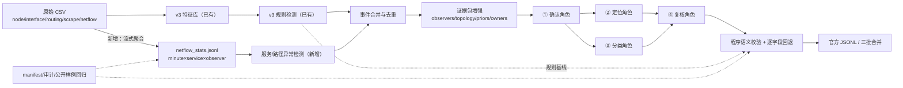

# v3 优化 + LLM 多角色接入实施计划（2026-10-18）

> **For agentic workers:** REQUIRED SUB-SKILL: Use superpowers:subagent-driven-development (recommended) or superpowers:executing-plans to implement this plan task-by-task. Steps use checkbox (`- [ ]`) syntax for tracking.

**Goal:** 在不改官方格式、不碰隐藏标签的前提下，把 v3 从「纯规则、批2/批3 大面积漏 service/link 故障」升级为「多源证据 + 四角色 LLM 诊断 + 程序语义校验 + 逐字段回退」的可提交流水线。

**Architecture:** 保留 v3 的确定性事件检测（LLM 不增删事件），新增两条证据通道（原始 NetFlow 五元组的服务/路径异常、路由维度扩展），把证据包扩成「观测者矩阵 + 拓扑 + 候选先验 + 证据归属」，再由同一模型跑四个独立会话的角色（确认 / 定位 / 分类 / 复核）。每个角色的输出先过程序语义校验，再按字段回退到规则值；任何失败都不会伪造结论。

**Tech Stack:** Python 3.10+（沿用现有 `.venv`，无新增运行时依赖）、numpy、vLLM + Qwen3-8B-AWQ（服务器单卡）、现有 `aiops_v3` 模块、pytest。

**Spec:** 本文件即规格；上游依据为 `docs/requirements/AIOPS_OnePage.md`、`docs/v3-current-state.md`、`outputs/official_rules_20261017.txt`、`outputs/v4_v5_optimization_plan_20261017.md`、`docs/v3-server-llm-handoff.md`。v4 失败的教训以 `docs/v4-score-regression-audit-2026-10-17.md`（v4 分支）为准。

---

## 0. 现状与目标

| 项 | 数值 | 含义 |
|---|---|---|
| 已评分 | 22.79 / 60（批1+批2 加权） | 目前最好已知成绩 |
| v4 对照 | 12.07 | 证明「堆 Agent、收窄候选、强制 5 候选」会退步 |
| 最终权重 | 批1 20%、批2 40%、批3 40% | **80% 的分在批2/批3** |
| 批2/批3 输出 | 76 / 173 条，service、link 类为 0 | 规则体系依赖 traffic 探针，而批2/3 没有 |
| 子类覆盖 | 全三批 13/32 | `link` 4 类全程 0；firewall 只有 CPU |
| 已核实漏检 | 批3 至少 5 段服务不可用窗口无预测；批2 已见 2 段 | 证据来自原始 NetFlow 五元组请求/响应比 |

**目标（按收益排序）：**

1. 批2/批3 补出「服务不可用 / 路径不可达」类事件，并给出正确根因与类别（新增证据通道）。
2. 批1 的 135 条弱定位事件用多观察者一致性修正根因/分类（不再默认同城 service-vm）。
3. 接入四角色 LLM，让模型在**证据充分且可校验**的范围内改根因、类别、边界；用机制矩阵堵住 v4 那种「引用存在但设备/指标不符」的漏洞。
4. 所有改动可回退：规则值永远是 fallback，失败/超时/非法输出都不改变原预测结构。

**非目标：** 不重写 v3 检测器；不做 v4 那种大而全的三层库；不追求批1 的额外收益（批1 先冻结）；不引入需要 GPU 本地推理的组件（Mac 只跑规则与校验）。

---

## 1. 关键设计决策

- **D1 证据先行**：每个角色先输出观测/支持/反证，再给结论；输出 schema 字段顺序固定。
- **D2 事件所有权**：LLM 不能增删事件、不能选候选集外网元；确认角色只能在 ±10 分钟内微调边界且不得超 30 分钟。
- **D3 机制矩阵校验**（修 v4 最大漏洞）：每个类别族（resource/link/firewall/routing/service）定义「允许的证据特征族」；引用的证据必须属于被选根因设备，且特征族与类别匹配，否则整条角色输出作废、回退规则。
- **D4 逐字段回退**：定位失败→规则 Top5；分类失败→规则类别；确认失败→规则边界；复核 reject 只回退该字段，不整条丢弃。
- **D5 角色范围可切换**：`--role-scope all`（最终提交）与 `ambiguous`（省时/消融）；清晰单证据资源事件在 `ambiguous` 下走规则快路径。
- **D6 批1 先冻结**：第一轮只对批2/批3 启用新通道与角色，批1 保持现有 319 条（提交 S1/S2 与 S0 对比后再决定是否动批1）。
- **D7 公平性**：阈值只从**本批次自身**的分钟统计自动计算（基线比率、请求量中位数），不跨批迁移标签；批1 只用于开发期单元测试的 fixture，不用于批2/3 调参。
- **D8 可复现**：所有新产物记录输入文件 SHA、代码 SHA、配置与阈值；角色响应按 `(event_id, evidence_sha256, role, prompt_sha256, model revision)` 校验后续跑。
- **D9 哈希失效规则**：`EvidencePack` 增加字段会改变 `sha256()`，因此批2/批3 必须用新证据包重新生成角色响应；旧 `outputs/v3/server_*` 响应不得复用（导入器会因哈希不符拒绝，这是预期行为）。

---

## 2. 总体架构



**角色职责：**

| 角色 | 输入 | 输出 | 程序校验 |
|---|---|---|---|
| ① 确认 | 事件窗口、信号分层、观测者矩阵、质量/缺口、规则基线 | supported/uncertain、可选边界、支持/反证证据 | 边界范围与时长；证据 id 存在 |
| ② 定位 | 确认事件 + 候选（≤12）+ 每候选证据归属 | rank 1–5 网元 + 各自证据 | 网元在候选内且唯一；每网元引用本网元证据；rank1 强度 |
| ③ 分类 | 同一确认事件（不读定位） | 官方 major/sub + 机制证据/反证 | 类别合法；机制族匹配；与根因设备类型兼容 |
| ④ 复核 | ①+②+③+证据 | 三项 accept/reject + 反证 | accept 需三项合法；reject 必须有反证 id |

---

## 3. 文件结构

| 文件 | 动作 | 职责 |
|---|---|---|
| `aiops_v3/netflow_stats.py` | 新建 | 流式读取原始 5 元组 CSV（支持目录/glob/清单、带引号 CSV），聚合 `minute×service×observer` 紧凑 JSONL + manifest |
| `aiops_v3/netflow_detection.py` | 新建 | 从 stats 检测服务不可用（全观察者）与路径不可达（子集观察者），输出事件/信号 |
| `aiops_v3/classification.py` | 新建 | 机制矩阵：`evidence_family`、`mechanism_compatible(category, families, root)`，规则与校验器共用 |
| `aiops_v3/roles.py` | 新建 | 四角色 JSON schema、prompt 构造、输出校验（确认/定位/分类/复核） |
| `aiops_v3/role_runner.py` | 新建 | 批量调用 vLLM（urllib，沿用 server_llm 风格）、续跑缓存、审计、summary |
| `aiops_v3/role_import.py` | 新建 | 把已校验的角色结果按字段应用到 `Diagnosis` + 边界，记录回退原因 |
| `aiops_v3/detection.py` | 修改 | `DetectorSettings` 增加 netflow 开关；`detect_with_audit` 合并新增事件；事件去重 |
| `aiops_v3/diagnosis.py` | 修改 | `EvidencePack` 增加 observers/topology/candidate_priors/evidence_owners/quality；候选生成用多观察者先验 |
| `aiops_v3/run.py` | 修改 | 新参数 `--netflow-stats/--netflow-events/--diagnoser roles-jsonl/--role-results/--role-scope/--boundary-refine`；manifest 记录新哈希 |
| `aiops_v3/config/fault_taxonomy.json` | 不改 | 32 类官方枚举来源 |
| `tests/v3/test_netflow_stats.py` | 新建 | 解析/聚合/带引号 CSV/缺口的单元测试 |
| `tests/v3/test_netflow_detection.py` | 新建 | 全观察者/单观察者/缺口/阈值测试 |
| `tests/v3/test_classification.py` | 新建 | 机制矩阵与 v4 回归样例（traffic 指标不能证明 CPU 类） |
| `tests/v3/test_roles.py` | 新建 | 四角色校验器、非法引用、类别机制不符、边界越界 |
| `tests/v3/test_role_runner.py` | 新建 | 假后端、续跑、非法缓存、逐字段回退 |
| `tests/v3/test_role_import.py` | 新建 | 定位/分类/边界逐字段回退、事件数不变 |
| `tests/v3/test_run_netflow.py` | 新建 | 端到端：stats→事件→预测→契约校验 |
| `docs/plans/2026-10-18-v3-llm-multirole-optimization.md` | 本文件 | 计划 |
| `docs/v3-optimization-results-2026-10-19.md` | 新建（执行后） | 结果、消融、提交记录、边界 |

---

### Review Focus（实现者最可能踩的输入/条件）

1. **带引号 CSV**（批3 最后一段 `20261013-20261015` 整行带引号）→ T1 fixture 必须覆盖，否则该段服务事件全部丢失。
2. **数据缺口被误判为服务中断**（某分钟无任何服务流 ≠ 响应为 0）→ T2 必须以「请求观测存在」为前提。
3. **只坏一条路径**（单观察者失败）不能被当成服务故障，也不能丢弃 → T2 `subset` + T4 观察者城市候选先验。
4. **模型引用别的设备指标**（v4 的真实错误：traffic 记录被当成 CPU 证据）→ T6 的 `cross_device_evidence` 与机制矩阵必须拒绝。
5. **角色输出合法但机制不符**（例如 category=resource/cpu 却只引用 netflow）→ T5/T6 联合校验，失败回退规则。

## 4. 全局约束

- **截止时间**：初赛提交截止 2026-10-19 18:00；硬停 16:00 留提交余量。每天最多 5 次提交。
- **公平性**：不得使用批1 标签/反馈训练或调参用于批2/3；每批阈值只由本批统计计算（`Q24`）。公开样例只用于回归，不作为隐藏集准确率证据。
- **官方契约**：`prediction_id` 全局唯一；时间 UTC 毫秒 `+00:00`；`root_cause_top5` 恰好 5 个、rank 1–5 连续、网元官方唯一；类别 32 类配对；单事件时长 1–1800 秒。
- **模型**：`Qwen/Qwen3-8B-AWQ`，固定 revision SHA，temperature 0，`enable_thinking=false`，JSON schema 输出；同一模型、四个独立会话。
- **安全**：模型输出不落盘代码/密钥；审计只记 id、哈希、耗时、usage；`simulated` 标记必须显式为 false 才能用于提交。
- **不覆盖**：所有新产物写新目录；根目录 `result.jsonl` 只在最终确认后替换，且先备份为 `outputs/v3/result_frozen_20261018.jsonl`。

---

## 5. 里程碑与时间预算（约 26h，含缓冲）

| 里程碑 | 时间 | 交付 | 门禁 |
|---|---|---|---|
| M0 冻结 | 0.5h | 基线文件哈希、S0 提交、`v3-opt` 分支 | 现有 119 项测试通过 |
| M1 NetFlow 证据 | 3h | stats + 检测器通过测试；批2 stats 建好 | 单测通过；批2 事件数合理（预期 5–20） |
| M2 规则增强 | 2.5h | 证据包增强、机制矩阵、批2 试点 | 公开样例 96.011 不变；批1 字节不变 |
| M3 角色层 | 4h | 四角色协议/运行器/导入通过假后端测试 | 校验器覆盖全部拒绝路径 |
| M4 服务器冒烟 | 3h | vLLM 服务 + 20 条冒烟；批2 全量角色 | 合法率 ≥95%，回退 ≤20% |
| M5 批3 + 合并 | 5h | 批3 stats、全量角色、三批合并、S1/S2 | 契约校验 100%，审计通过 |
| M6 消融/收尾 | 3h | S4、结果文档、回滚说明 | 最终文件哈希与提交记录 |
| 缓冲 | 2h | — | — |

---

## 6. 任务清单

### T0：冻结基线与分支

**Files:**
- Create: `outputs/v3/result_frozen_20261018.jsonl`（拷贝）
- 修改：git 分支

**Interfaces:**
- Produces：冻结文件 SHA256，后续所有对比以它为基准。

- [ ] **Step 1: 跑现有测试并记录**

```bash
.venv/bin/python -m pytest -q
```

Expected: 119 passed（若前缀守卫测试已提交则更多）；失败先记录，不在此任务修。

- [ ] **Step 2: 冻结当前提交文件**

```bash
cp result.jsonl outputs/v3/result_frozen_20261018.jsonl
shasum -a 256 result.jsonl outputs/v3/result_frozen_20261018.jsonl
```

- [ ] **Step 3: 建分支并提交未提交的 stage3 守卫改动**

```bash
git checkout -b v3-opt
git add aiops_v3/detection.py aiops_v3/run.py tests/v3/test_blackhole_onset.py docs/v3-stage3-prefix-onset-2026-10-17.md README.md
git commit -m "chore: freeze v3 baseline before multi-role optimization"
```

- [ ] **Step 4: 提交 S0（现有 568 条）拿批3 首个官方信号**

由有提交权限的队员执行 `submit.py`（本计划不代提交）。记录回执与总分到 `docs/v3-optimization-results-2026-10-19.md` 草稿。

**Acceptance:** 冻结文件哈希已记录；S0 已提交并记录分数；`git status` 干净（除 outputs/data 忽略项）。

---

### T1：NetFlow 紧凑统计构建器

**Files:**
- Create: `aiops_v3/netflow_stats.py`
- Test: `tests/v3/test_netflow_stats.py`
- Create（执行产物）: `data/netflow_stats/stage2_service.jsonl`、`data/netflow_stats/stage3_service.jsonl`、各自 `manifest.json`

**Interfaces:**
- `SERVICES = {"dns": ("fd00:%d:40::31", 1053), "web": ("fd00:%d:40::31", 80), "auth": ("fd00:%d:40::31", 8080)}`，其中 `%d` 用城市号 `{"beida":1,"shenyang":2,"xian":3,"chengdu":4,"wuhan":5,"shanghai":6,"nanjing":7,"guangzhou":8}`。
- `build(inputs: list[Path], output: Path, *, start_time: datetime, minute_count: int) -> dict`：返回 manifest dict（`input_sha256`、`rows`、`minutes`、`services`、`owners`、`code_sha256`）。
- `load_stats(path: Path) -> tuple[dict, ...]`：读取 JSONL 为内存行，供检测器与 run.py 复用（不做任何阈值判断）。
- 输出行：`{"minute": int, "service": "dns|web|auth", "service_node": "beida-service-vm-1", "observer_city": "beida|...", "req_pkts": float, "resp_pkts": float, "req_bytes": float, "resp_bytes": float}`。
- 观察者判定：请求 `dst_addr == fd00:<target_digit>:40::31 且 dst_port == 服务端口`，`src_addr` 按 `fd00:([1-8]):40::10` 提取源城市；响应反向（`src_addr` 为服务地址、`src_port` 为服务端口、`dst_addr` 为 `fd00:<c>:40::10`）。
- 兼容：字段带引号、BOM、CRLF、`\N`、行序无关；非服务流直接跳过（不可把 `fd00:*:40::31:5201` 当服务）。

- [ ] **Step 1: 写失败测试（fixture CSV 内联字符串）**

`tests/v3/test_netflow_stats.py::test_aggregates_service_request_response_by_observer`：两行请求 + 两行响应（不同源城市），断言输出两行、`req_pkts`/`resp_pkts` 正确、`observer_city` 正确；`::31:5201` 与 `::33` 行被忽略。

```python
rows = read_jsonl(result)
assert {(r["service"], r["observer_city"]) for r in rows} == {("dns", "beida"), ("dns", "xian")}
assert [r["resp_pkts"] for r in rows] == [3, 1]
```

- [ ] **Step 2: 跑测试确认失败**

Run: `.venv/bin/python -m pytest tests/v3/test_netflow_stats.py -v`
Expected: FAIL `ModuleNotFoundError` / `AttributeError`。

- [ ] **Step 3: 实现最小 `build` 与 CLI**

流式 `csv.DictReader`；内部 dict `key=(minute, service, observer_city)` 累加；`minute` 由 `minute_utc` 减 `start_time` 得到并校验 `0 <= minute < minute_count`；按 `(minute, service, observer_city)` 排序写出；CLI 参数 `--input-list/--input/--output/--start-time/--minute-count`。

- [ ] **Step 4: 再补两个测试并跑通**

`test_quoted_and_crlf_csv_is_parsed`（整行带引号，如批3 最后一段）；`test_gap_minutes_are_not_fabricated`（某分钟无任何服务行，则输出中不存在该分钟，不得补 0）。

Run: `.venv/bin/python -m pytest tests/v3/test_netflow_stats.py -v` → PASS

- [ ] **Step 5: 建批2 统计并人工抽查**

```bash
mkdir -p /tmp/stage2_extract && cd /tmp/stage2_extract
unzip -o -q "/Users/likevin/lmh/CCF_AIOps_2026/data/stage2/archives/【批量下载】beida_20260917040000_20260919040000.tar.gz.zip"
for t in *.tar.gz; do tar -xzf "$t"; done
find . \( -path '*/beida/*netflow_5tuple*.csv' -o \
          -path '*/shanghai/*netflow_5tuple*.csv' -o \
          -path '*/wuhan/*netflow_5tuple*.csv' \) > /tmp/netflow_stage2_inputs.txt
wc -l /tmp/netflow_stage2_inputs.txt   # 预期 9
cd /Users/likevin/lmh/CCF_AIOps_2026
.venv/bin/python -m aiops_v3.netflow_stats --input-list /tmp/netflow_stage2_inputs.txt \
  --output data/netflow_stats/stage2_service.jsonl \
  --start-time 2026-09-17T04:00:00+00:00 --minute-count 10080
```

抽查：DNS 每分钟请求中位数 > 1000；响应/请求中位数 = 1.0；`resp/req < 0.5` 的分钟与已知两段窗口一致（09-18 23:04–23:25、09-19 03:21–03:44）。

- [ ] **Step 6: 建批3 统计（单进程顺序，先告知使用者占用约 15–25 分钟）**

```bash
find data/stage3/regions \( -path '*/beida/*netflow_5tuple*.csv' -o \
  -path '*/shanghai/*netflow_5tuple*.csv' -o -path '*/wuhan/*netflow_5tuple*.csv' \) \
  > /tmp/netflow_stage3_inputs.txt
wc -l /tmp/netflow_stage3_inputs.txt   # 预期 15
.venv/bin/python -m aiops_v3.netflow_stats --input-list /tmp/netflow_stage3_inputs.txt \
  --output data/netflow_stats/stage3_service.jsonl \
  --start-time 2026-10-01T04:00:00+00:00 --minute-count 20160
```

Expected：DNS 20,160 分钟覆盖、5 段低比率窗口；auth ≥1 段（10-13 02:56–03:15）；web ≥1 段。

- [ ] **Step 7: 提交**

```bash
git add aiops_v3/netflow_stats.py tests/v3/test_netflow_stats.py
git commit -m "feat(netflow): build compact service/observer minute statistics"
```

**Acceptance:** 单测通过；批2/批3 stats 与本次人工核验一致（窗口、基线 1.000、覆盖分钟数）；manifest 记录输入/代码 SHA；全程单进程，不并行扫盘。

---

### T2：服务/路径异常检测器

**Files:**
- Create: `aiops_v3/netflow_detection.py`
- Test: `tests/v3/test_netflow_detection.py`

**Interfaces:**
- `NetflowSettings(min_ratio=0.5, min_requests=100, min_minutes=1, max_event_minutes=30, min_observer_requests=20, require_observed_minutes=True)`
- `detect(stats_rows: Iterable[dict], *, minute_count: int) -> tuple[NetflowEvent, ...]`，`NetflowEvent(start_minute, end_minute, service, service_node, scope)`，`scope ∈ {"all","subset"}`。
- `to_signals(event, city_devices) -> tuple[Signal, ...]`：`all` 在 `service_node` 上给 direct（feature `netflow.service.response_ratio`，category `service_down`）；`subset` 在 `service_node` 上给 symptom，并在受影响城市 `br-1/br-2/cr-1/cr-2/fw` 上给 context（feature `netflow.path.response_ratio`，category `path_unreachable`）。

**算法（固定值，勿自创）：**
1. 每个 service 的分钟总有请求 `≤ min_requests` 或缺失 → 不参与判定（数据缺口）。
2. 基线 `baseline_ratio = median(resp/req)`，只用请求量 ≥ `min_requests` 的分钟。
3. 低分钟：`req ≥ max(min_requests, 0.2 * median_req)` 且 `ratio < min_ratio`。
4. 连续低分钟按 gap ≤1 合并；长度 < `min_minutes` 丢弃；超过 `max_event_minutes` 按 30 分钟切段。
5. 观察者判定：对窗口内每分钟、每个 observer 计算自己的比率（该 observer 请求量 ≥ `min_observer_requests`）；低观察者数 = 1 → `subset`；≥2 → `all`；0 → 丢弃（数据缺口）。
6. 事件覆盖的每一分钟必须存在该 service 的请求观测，否则整段丢弃（`require_observed_minutes`）。

- [ ] **Step 1: 写失败测试**

```python
def test_all_observers_low_yields_all_scope():
    rows = [row("dns", "beida", minute, req=1000, resp=999) for minute in range(0, 10)]
    rows += [row("dns", city, minute, req=500, resp=0) for city in ("beida", "xian") for minute in range(10, 16)]
    events = detect(rows, minute_count=100)
    assert [(e.start_minute, e.end_minute, e.scope) for e in events] == [(10, 16, "all")]
```

另写：`test_single_observer_low_yields_subset`、`test_gap_minutes_block_event`、`test_short_glitch_is_dropped`、`test_long_window_is_split_at_30`。

- [ ] **Step 2: 跑测试确认失败**

Run: `.venv/bin/python -m pytest tests/v3/test_netflow_detection.py -v` → FAIL

- [ ] **Step 3: 实现并跑通**

Run: `.venv/bin/python -m pytest tests/v3/test_netflow_detection.py -v` → PASS

- [ ] **Step 4: 用批2/批3 真实 stats 离线列出事件（不写预测）**

```bash
.venv/bin/python -m aiops_v3.netflow_detection \
  --stats data/netflow_stats/stage2_service.jsonl --out /tmp/nf_stage2_events.jsonl
```

Expected：批2 至少 2 段 DNS；批3 至少 5 段 DNS + 1 段 auth（±1 段 web）。逐条检查起止与观察者数。

- [ ] **Step 5: 提交**

```bash
git add aiops_v3/netflow_detection.py tests/v3/test_netflow_detection.py
git commit -m "feat(netflow): detect service-wide and path-specific response loss"
```

**Acceptance:** 单测覆盖 all/subset/缺口/短脉冲/30 分钟切段；真实 stats 事件窗口与 T1 抽查一致；无事件时长越界。

---

### T3：检测层集成（事件合并、去重、规则先验）

**Files:**
- Modify: `aiops_v3/detection.py`（`DetectorSettings` 增 `netflow_events: bool = False`、`netflow_stats_path: str | None = None`）
- Test: `tests/v3/test_detection.py` 追加

**Interfaces:**
- Modify `Event`（`aiops_v3/detection.py`）：增加默认空字段 `observers: tuple[dict, ...] = ()`，保存该事件的观察者分钟表（由 netflow 检测器填充）；旧构造不传该字段，行为不变。
- `detect_with_audit(store, settings)` 内部：若启用，读 stats（新模块 `load_stats`），`detect()` 得到 `NetflowEvent`，转 `Event(..., observers=rows)`，与规则事件合并。
- 合并规则（精确值）：新事件与任一规则事件时间重叠 ≥1 分钟且（同为 service_node 同城 或 根因城市相同）→ 合并为一个事件：窗口取并集、截断 30 分钟、signals 与 observers 去重；否则保留独立事件。
- 独立 netflow 事件规则分类先验写入 signals：`all` → `("service", {"dns":"dns_down","web":"web_5xx","auth":"auth_timeout"}[service])`；`subset` → `("link","loss")`。

- [ ] **Step 1: 写失败测试（用小型 fake store + 内联 stats 文件）**

```python
def test_netflow_event_is_added_and_classified(tmp_path):
    ...  # 10 分钟无规则事件；stats 给出 DNS all 窗口
    result = detect_with_audit(store, DetectorSettings(netflow_events=True, netflow_stats_path=str(p)))
    categories = {signal.category for event in result.events for signal in event.signals}
    assert categories == {"service_down"}
    assert any("netflow.service.response_ratio" == signal.feature for event in result.events for signal in event.signals)
```

再写 `test_netflow_event_merges_into_overlapping_rule_event` 与 `test_netflow_event_does_not_duplicate_same_window`。

- [ ] **Step 2: 跑测试确认失败 → 实现 → 通过**

Run: `.venv/bin/python -m pytest tests/v3/test_detection.py -v`

- [ ] **Step 3: 回归：批1 不带开关时字节不变**

```bash
.venv/bin/python -m aiops_v3.run --input-store data/feature_store/v3/stage1_canonical_20260930 \
  --output-dir /tmp/regress_stage1 --detector-profile conservative --routing-dimension-detection \
  --routing-context-candidates --temporal-context --exact-bgp-session-merge
cmp /tmp/regress_stage1/predictions.jsonl \
  outputs/v3/stage1_exact_bgp_candidate_verified_20261003/predictions.jsonl
```

Expected: 无差异（除 prediction_id 重编号外应完全一致；若 id 有差异，用去掉 id 的对比脚本记录）。

- [ ] **Step 4: 提交**

```bash
git add aiops_v3/detection.py tests/v3/test_detection.py
git commit -m "feat(detection): merge netflow service/path events with rule events"
```

**Acceptance:** 新事件可生成且类别正确；重叠事件合并且不重复；批1 关闭开关时行为不变。

---

### T4：证据包增强与多观察者先验

**Files:**
- Modify: `aiops_v3/diagnosis.py`
- Test: `tests/v3/test_diagnosis.py` 追加
- Test: `tests/v3/test_public_samples.py`（已有则复用）

**Interfaces:**
- `EvidencePack` 增字段（带默认值，保持旧构造可用）：
  - `observers: tuple[dict, ...]`：每行 `{"kind":"traffic|netflow","source_city","target","req","resp","ratio","stance":"support|counter"}`
  - `topology: dict[str, tuple[str, ...]]`：`node -> ("role:br", "city:beida", "adjacent:beida-br-1,...")`
  - `candidate_priors: dict[str, str]`：候选先验原因（如 `service_target`、`path_observer_city_device`、`direct_evidence`）
  - `evidence_owners: dict[str, str]`：证据 id → 拥有该观测的节点（供 D3 校验）
  - `quality: dict`：覆盖/缺口/弱证据标记
- `build_evidence(...)`：当事件含 `netflow.*` 或 `path_unreachable` 信号时，`pack.observers = event.observers`（不重新读 stats，保证证据包只依赖事件）；按 `service_node`/观察者城市生成候选先验：
  - `all` 服务事件：`service_node` 先验 `service_target`（score 0.95），同城 `service-vm-2/3` 0.6，同城 `fw/cr-1/br-1` 0.45。
  - `subset` 路径事件：受影响城市 `br-1` 0.9、`fw` 0.8、`cr-1` 0.75、`br-2` 0.7，`service_node` 0.5。
- `evidence_owners`：按信号 id 规则填充——`node:*` 的 owner 是信号 `node`；`edge:traffic` 的 owner 是 `target`；`netflow.service.response_ratio` 的 owner 是 `service_node`；`netflow.path.response_ratio` 的 owner 是该观察者城市的 `br-1`（若无则 `br-2`）；`dimension:*` 的 owner 是信号 `node`。所有 `pack.signals` 的 id 必须出现在 owners 中（测试断言）。
- 候选排序仍截断 12，但同分按先验原因、再按节点名排序（确定性）。

- [ ] **Step 1: 写失败测试**

```python
def test_subset_path_event_prioritises_observer_city_router():
    pack = build_evidence(store, path_event, contract)
    assert pack.candidates[0].node == "xian-br-1"
    assert pack.candidate_priors["xian-br-1"] == "path_observer_city_device"
    assert pack.candidates[0].evidence_ids
```

再写 `test_service_wide_event_prioritises_target_service_vm`、`test_evidence_owners_cover_all_signal_ids`、`test_existing_packs_remain_compatible`。

- [ ] **Step 2: 跑测试失败 → 实现 → 通过**

Run: `.venv/bin/python -m pytest tests/v3/test_diagnosis.py -v`

- [ ] **Step 3: 公开样例回归（必须不变）**

```bash
.venv/bin/python -m pytest tests/v3/test_public_samples.py -q
.venv/bin/python -m aiops_v3.evaluation --ground-truth sample/ground_truth.jsonl \
  --predictions artifacts/public-sample-v1/predictions.jsonl --report /tmp/pub.json
```

Expected: Total 96.011111，TP3/FP0/FN0。

- [ ] **Step 4: 提交**

```bash
git add aiops_v3/diagnosis.py tests/v3/test_diagnosis.py
git commit -m "feat(evidence): add observer matrix, topology priors and evidence owners"
```

**Acceptance:** 新事件候选先验正确；旧构造兼容；公开样例不变。

---

### T5：机制矩阵与分类模块

**Files:**
- Create: `aiops_v3/classification.py`
- Test: `tests/v3/test_classification.py`

**Interfaces:**
- `FAMILY_RULES: dict[tuple[str,str], frozenset[str]]`，例如：
  - `("resource","cpu_pressure") -> {"node.cpu_usage"}`
  - `("resource","memory_pressure") -> {"node.memory_available_ratio"}`
  - `("resource","disk_io_pressure") -> {"node.disk_io_util","node.disk_read_rate","node.disk_write_rate"}`
  - `("resource","disk_space_low") -> {"node.filesystem_used_ratio","node.inode_used_ratio"}`
  - `("resource","process_pressure") -> {"node.process_count","node.open_fd_ratio"}`
  - `("firewall","cpu_pressure") -> {"node.cpu_usage"}`
  - `("link","loss") -> {"interface.rx_drop_rate","interface.tx_drop_rate","interface.rx_error_rate","interface.tx_error_rate","interface.carrier_changes","netflow.path.response_ratio"}`
  - `("link","delay") -> {"traffic.*.latency_p95_seconds","netflow.path.response_ratio"}`（本批无探针则只用 netflow）
  - `("routing","*") -> {"routing.*","netflow.service.response_ratio"}`（仅限根因为 br/cr）
  - `("service","*") -> {"traffic.*","netflow.service.response_ratio"}`
- `evidence_family(feature: str) -> str`：把 feature 映射到 `node/interface/routing/traffic/netflow` 族。
- `mechanism_compatible(major: str, sub: str, families: set[str], root: str) -> str | None`：返回 `None` 表示通过，否则返回拒绝原因码（`mechanism_missing`、`root_type_mismatch`、`cross_device_evidence`）。
- `is_clear_event(pack: EvidencePack, rules: Diagnosis) -> bool`：恰好 1 个 direct 节点、所有 direct 信号同类别、该节点候选 score 领先第二名 ≥0.15、规则类别通过机制矩阵。
- 根因类型规则：`service` → root endswith `-service-vm-1/2/3`；`firewall` → root endswith `-fw`；`link`/`routing` → root role ∈ {br,cr,fw}；`resource` → 任意。

- [ ] **Step 1: 写失败测试（含 v4 回归）**

```python
def test_traffic_metric_cannot_justify_cpu_category():
    assert mechanism_compatible("resource", "cpu_pressure", {"traffic"}, "beida-service-vm-1") == "mechanism_missing"

def test_service_category_requires_service_root():
    assert mechanism_compatible("service", "dns_down", {"netflow"}, "beida-br-1") == "root_type_mismatch"

def test_netflow_path_evidence_supports_link_loss_for_router_root():
    assert mechanism_compatible("link", "loss", {"netflow"}, "xian-br-1") is None
```

再写 `test_resource_family_map_covers_all_used_subcategories`（对 v3 已用 13 类逐一断言有映射）。

- [ ] **Step 2: 跑测试失败 → 实现 → 通过**

Run: `.venv/bin/python -m pytest tests/v3/test_classification.py -v`

- [ ] **Step 3: 让规则分类复用同一矩阵（只在新流程启用时生效）**

在 `diagnosis._category` 中增加 `use_mechanism_matrix: bool = False` 参数：仅当 run.py 传入 `--netflow-events` 或 `--diagnoser roles-jsonl` 时为 True；为 False 时行为与现状完全一致，保证批1 回归。True 时若规则首选项的机制不匹配，则从证据里重新选一个匹配项，仍无则回退 `("resource","cpu_pressure")`。

- [ ] **Step 4: 回归：批1 不带新开关时逐字节不变**

```bash
.venv/bin/python -m aiops_v3.run --input-store data/feature_store/v3/stage1_canonical_20260930 \
  --output-dir /tmp/regress_stage1_matrix --detector-profile conservative \
  --routing-dimension-detection --routing-context-candidates --temporal-context \
  --exact-bgp-session-merge
cmp /tmp/regress_stage1_matrix/predictions.jsonl \
  outputs/v3/stage1_exact_bgp_candidate_verified_20261003/predictions.jsonl
```

- [ ] **Step 5: 提交**

```bash
git add aiops_v3/classification.py tests/v3/test_classification.py aiops_v3/diagnosis.py
git commit -m "feat(classification): add mechanism matrix shared by rules and validators"
```

**Acceptance:** 机制矩阵覆盖 v3 现有类别；v4 的两类语义错误被拒绝；批1 预测不变。

---

### T6：四角色协议与校验器

**Files:**
- Create: `aiops_v3/roles.py`
- Test: `tests/v3/test_roles.py`

**Interfaces（固定签名）：**
```python
ROLE_NAMES = ("confirm", "localize", "classify", "review")

def build_request(role: str, pack: EvidencePack, *, baseline: Diagnosis,
                  upstream: dict[str, dict]) -> dict
def validate(role: str, pack: EvidencePack, body: dict, *,
             baseline: Diagnosis, upstream: dict[str, dict]) -> str | None
```
- `upstream` 只允许：confirm 收到 `{}`；localize/classify 收到 `{"confirm": ...}`；review 收到 `{"confirm":..., "localize":..., "classify":...}`。
- 输出 schema（字段顺序即 prompt 里的顺序）：
  - confirm：`{"verdict":"supported|uncertain","boundary":{"start_minute":int,"end_minute":int}|null,"support_evidence_ids":[...],"counter_evidence_ids":[...],"observations":[...],"missing":[...]}`
  - localize：`{"ranked":[{"rank":1,"network_element_id":str,"evidence_ids":[...],"mechanism":str}],"observations":[...],"counter_evidence_ids":[...]}`
  - classify：`{"major_category":str,"sub_category":str,"mechanism_evidence_ids":[...],"counter_evidence_ids":[...],"observations":[...]}`
  - review：`{"confirm":"accept|reject","localize":"accept|reject","classify":"accept|reject","support_evidence_ids":[...],"counter_evidence_ids":[...],"notes":str}`
- 校验规则（写死）：
  - confirm：边界必须 `event.start-10 <= boundary.start < boundary.end <= event.end+10`、`1 <= end-start <= 30`、与原窗口 Dice ≥ 0.6；verdict=uncertain 时 boundary 必须为 null；引用的 support id 必须存在。
  - localize：rank 恰为 1..len；网元在 `pack.candidates` 内且唯一；**每个网元的 evidence_ids 非空，且每个 id 的 `evidence_owners[id]` 等于该网元**；rank1 额外要求：至少一条 direct 证据，或 service 事件的 `observers` 中 ≥2 个观察者支持，或 path 事件中该网元所在城市是被影响城市。
  - classify：类别对必须在 `contract.categories`；`mechanism_evidence_ids` 非空；用 T5 矩阵校验 `mechanism_compatible(...)` 返回 None。
  - review：三项 accept 时对应上游必须存在且已通过校验；reject 必须给出非空 `counter_evidence_ids`；review 不得改边界。
- prompt 共性：系统提示声明「观测者不是根因」「拓扑邻接不是现象」「规则基线只是参考，改判必须引用证据」「只输出 JSON」；用户消息按 `observations → support → counter → missing → conclusion` 字段序；`temperature=0`，`max_tokens=768`，`response_format=json_schema`。

- [ ] **Step 1: 写失败测试（每个拒绝路径一条）**

```python
def test_localize_rejects_cross_device_citation():
    body = {"ranked":[{"rank":1,"network_element_id":"beida-br-1",
                       "evidence_ids":["node:5:0:node.cpu_usage"],"mechanism":"x"}]}
    assert validate("localize", pack, body, baseline=rules, upstream={}) == "cross_device_evidence"
```
再从 `test_roles.py` 覆盖：越界边界、rank 重复、类别机制不符、review 无证据 reject、review 缺上游。

- [ ] **Step 2: 跑测试失败 → 实现 → 通过**

Run: `.venv/bin/python -m pytest tests/v3/test_roles.py -v`

- [ ] **Step 3: prompt 快照测试**

断言 `build_request("confirm", ...)` 的 system 文本包含 "observer"、"topology"、"evidence" 三个关键词，且用户 JSON 里 `observations` 键出现在 `rule_baseline` 之前（JSON 有序输出）。

- [ ] **Step 4: 提交**

```bash
git add aiops_v3/roles.py tests/v3/test_roles.py
git commit -m "feat(roles): add four-role schemas, prompts and semantic validators"
```

**Acceptance:** 四角色校验器全部拒绝路径有测试；prompt 字段序固定；校验器与 T5 矩阵一致。

---

### T7：角色运行器（vLLM、续跑、审计）

**Files:**
- Create: `aiops_v3/role_runner.py`
- Test: `tests/v3/test_role_runner.py`

**Interfaces:**
- `run_roles(evidence_path: Path, out_dir: Path, *, model: str, revision: str,
  base_url: str, api_key: str | None = None, limit: int | None = None,
  timeout: int = 120, scope: str = "all", complete=None) -> dict`
  （`complete` 仅测试注入；生产默认 `server_llm._post_json(base_url, api_key, timeout)`。）
- 续跑键：`(event_id, evidence_sha256, role, prompt_sha256, model.repository, model.revision)`；不匹配即报错（沿用 `server_llm.run_batch` 语义）。
- 产物：`roles.jsonl`（每行 `{"event_id","evidence_sha256","role","prompt_sha256","model","status":"accepted|fallback","body":{...},"seconds":float}`）、`role_audit.jsonl`、`summary.json`（合法率、回退率、按角色耗时、token 用量若接口返回）。
- 失败语义：单角色超时/非法 JSON/校验失败 → 该角色记为 `fallback` 并继续下一角色；三字段互不影响。`simulated=false` 必须显式记录。
- `scope` 语义：`all` 对每个事件跑四角色；`ambiguous` 先调用 `is_clear_event(pack)`（定义见 T5），为真则跳过角色、记录 `fastpath=true`。`is_clear_event` 精确条件：恰好 1 个 direct 节点、所有 direct 信号同类别、该节点候选 score 领先第二名 ≥0.15、规则类别通过机制矩阵。

- [ ] **Step 1: 写失败测试（假 `complete`）**

```python
def test_runner_falls_back_per_role_and_resumes(tmp_path):
    calls = []
    summary = run_roles(evidence, out_dir, model="m", revision="r", base_url="http://x",
                        complete=fake_complete, limit=None)
    assert summary["roles"]["confirm"]["fallback"] == 0
    assert summary["roles"]["classify"]["fallback"] == 1  # fake 给了非法类别
```
注：为可测，`run_roles` 接受可选 `complete` 参数（默认 `server_llm._post_json(...)`）。

再写：续跑不重发；缓存 prompt hash 不符报错；重复 event_id 报错；`limit` 生效。

- [ ] **Step 2: 跑测试失败 → 实现 → 通过**

Run: `.venv/bin/python -m pytest tests/v3/test_role_runner.py -v`

- [ ] **Step 3: 服务器服务基准（真机，1–2 分钟）**

```bash
CUDA_VISIBLE_DEVICES=0 vllm serve Qwen/Qwen3-8B-AWQ --revision <REVISION> \
  --host 127.0.0.1 --port 8000 --max-model-len 8192 --max-num-seqs 8
```

跑 8 条请求记录墙钟；若 < 0.3 req/s，把 `--role-scope` 改为 `ambiguous` 并在结果文档记录。

- [ ] **Step 4: 提交**

```bash
git add aiops_v3/role_runner.py tests/v3/test_role_runner.py
git commit -m "feat(roles): add resumable four-role vLLM runner with per-role fallback"
```

**Acceptance:** 假后端测试覆盖回退/续跑/非法缓存；服务器 20 条冒烟合法率 ≥95%（真机数字写入结果文档）。

---

### T8：角色结果导入与逐字段回退

**Files:**
- Create: `aiops_v3/role_import.py`
- Modify: `aiops_v3/run.py`（`--diagnoser roles-jsonl`、`--role-results`）
- Test: `tests/v3/test_role_import.py`

**Interfaces:**
- `apply_roles(pack: EvidencePack, rules: Diagnosis, rows: dict[str, dict], contract) -> tuple[Diagnosis, dict, list[str]]`
  - 返回 `(diagnosis, boundary, fallback_reasons)`。
  - 定位：review.localize=accept 且 localize 校验通过 → 用模型 roots；否则规则 roots；不足 5 个用规则 roots 补齐（不得重复）。
  - 分类：review.classify=accept 且 classify 校验通过 → 模型类别；否则规则类别。
  - 边界：confirm.verdict=supported 且 review.confirm=accept 且边界校验通过 → 新窗口；否则规则窗口。
- `run.py`：`--diagnoser roles-jsonl` 时读 `--role-results`，对每个事件应用；输出 `audit.jsonl` 增加 `role_status` 与 `fallback_fields`；`run_manifest.json` 增加角色响应 SHA、模型 revision、prompt SHA。

- [ ] **Step 1: 写失败测试**

```python
def test_roles_can_change_category_but_not_event_count():
    diagnosis, boundary, fallbacks = apply_roles(pack, rules, rows, contract)
    assert diagnosis.category == ("link", "loss")
    assert len(predictions) == len(rules_events)  # 在 run 层断言
```
再写：定位非法→回退规则 roots；分类机制不符→回退规则类别；边界越界→回退原窗口；review reject→对应字段回退。

- [ ] **Step 2: 跑测试失败 → 实现 → 通过**

Run: `.venv/bin/python -m pytest tests/v3/test_role_import.py -v`

- [ ] **Step 3: 端到端（假后端）**

```bash
.venv/bin/python -m pytest tests/v3/test_run_netflow.py tests/v3/test_run.py -q
```

- [ ] **Step 4: 提交**

```bash
git add aiops_v3/role_import.py aiops_v3/run.py tests/v3/test_role_import.py tests/v3/test_run_netflow.py
git commit -m "feat(pipeline): apply validated role results per field with rule fallback"
```

**Acceptance:** 事件数/时间只允许确认角色按约束微调；任何角色失败都逐字段回退；manifest 可审计。

---

### T9：批2 试点（S1 前置，不单独提交）

**Files:**
- Create: `outputs/v3/opt_stage2_*/`（运行产物）
- Update: `docs/v3-optimization-results-2026-10-19.md`

- [ ] **Step 1: 批2 规则增强跑（只开 netflow 事件）**

```bash
.venv/bin/python -m aiops_v3.run \
  --input-store data/feature_store/v3/stage2_canonical_20261001 \
  --output-dir outputs/v3/opt_stage2_rules \
  --detector-profile conservative --routing-dimension-detection \
  --routing-context-candidates --temporal-context \
  --netflow-stats data/netflow_stats/stage2_service.jsonl --netflow-events
```

Expected：76 条基础上新增 2–8 条服务/路径事件；无重复窗口；逐条打印窗口/类别/根因。

- [ ] **Step 2: 审计（不提交）**

```bash
.venv/bin/python -m aiops_v3.prediction_audit \
  --stage2-run outputs/v3/opt_stage2_rules \
  --merged outputs/v3/opt_stage2_rules/predictions.jsonl \
  --report outputs/v3/opt_stage2_rules/audit_report.json
```

官方提交文件必须三批齐全，所以 S1 只能在 T10 批3 跑完后一起提交；本任务只产出批2 结果与差异表。

- [ ] **Step 3: 记录与决策**

把新增事件逐条写入结果文档；若单段事件只有 1 分钟或请求量偏低，标记为「不进最终文件」并在 T3 阈值内收紧 `min_minutes=2` 重跑。

**Acceptance:** 批2 新增事件数与证据一致；每个事件有可回查的 observer 表；差异表可供 S1 决策。

---

### T10：批3 全量 + 三批合并 + S1/S2 提交

- [ ] **Step 1: 批3 规则增强跑（先 rules-only）**

```bash
.venv/bin/python -m aiops_v3.run \
  --input-store data/feature_store/v3/stage3_canonical_20261017 \
  --output-dir outputs/v3/opt_stage3_rules \
  --detector-profile conservative --routing-dimension-detection \
  --routing-context-candidates --temporal-context --prefix-aware-blackhole \
  --netflow-stats data/netflow_stats/stage3_service.jsonl --netflow-events
```

Expected：173 条基础上新增 5–8 条；与既有 `disk_io_pressure` 重叠的服务窗口被合并并改类别。

- [ ] **Step 2: 先合并 S1（批1 冻结 + 批2/3 规则增强）并提交**

```bash
.venv/bin/python -m aiops_v3.merge \
  --input outputs/v3/stage1_exact_bgp_candidate_verified_20261003/predictions.jsonl \
  --input outputs/v3/opt_stage2_rules/predictions.jsonl \
  --input outputs/v3/opt_stage3_rules/predictions.jsonl \
  --output outputs/v3/submission_S1.jsonl
.venv/bin/python -m aiops_v3.prediction_audit ... --merged outputs/v3/submission_S1.jsonl \
  --report outputs/v3/submission_S1_audit.json
```

S1 提交后记录总分；这是「新增 NetFlow 证据通道」的单变量对照。

- [ ] **Step 3: 角色全量跑（服务器）**

```bash
# 服务器
python -m aiops_v3.role_runner --evidence outputs/v3/opt_stage3_rules/evidence.jsonl \
  --out-dir outputs/v3/opt_stage3_roles --model Qwen/Qwen3-8B-AWQ --revision <REVISION> \
  --base-url http://127.0.0.1:8000/v1 --role-scope all --limit 20
python -m aiops_v3.role_runner --evidence ... --out-dir ...   # 全量续跑
```

批2 同样处理。把 `roles.jsonl` 回传 Mac。

- [ ] **Step 4: 角色导入 + 合并 S2 并提交**

```bash
.venv/bin/python -m aiops_v3.run --input-store data/feature_store/v3/stage3_canonical_20261017 \
  --output-dir outputs/v3/opt_stage3_roles_run --diagnoser roles-jsonl \
  --role-results outputs/v3/opt_stage3_roles/roles.jsonl \
  --detector-profile conservative --routing-dimension-detection \
  --routing-context-candidates --temporal-context --prefix-aware-blackhole \
  --netflow-stats data/netflow_stats/stage3_service.jsonl --netflow-events
.venv/bin/python -m aiops_v3.merge \
  --input outputs/v3/stage1_exact_bgp_candidate_verified_20261003/predictions.jsonl \
  --input outputs/v3/opt_stage2_roles_run/predictions.jsonl \
  --input outputs/v3/opt_stage3_roles_run/predictions.jsonl \
  --output outputs/v3/submission_S2.jsonl
```

S1 = 批1 冻结 + 批2/3 规则增强；S2 = S1 + 批2/3 角色。两次提交间隔 ≥ 1 小时，记录总分。

**Acceptance:** 三批合并契约校验 100%；公开样例不变；每笔提交的 SHA 与总分写入结果文档。

---

### T11：批1 角色实验（S3，可选）

- [ ] **Step 1: 只在批1 跑角色，批2/3 用 S2 结果合并**

若 S2 总分 ≥ S1，说明角色层不亏；再试批1 角色版（S3）。若 S2 < S1，跳过本任务，保留 S1 为最终候选。

- [ ] **Step 2: 批1 变化必须可解释**

逐条列出 Top1/类别变化；任何「同类但无新证据」的改动应被校验器拒绝。预期收益主要来自那 135 条弱定位事件。

**Acceptance:** 批1 角色版与规则的差异表 ≤ 40 条且每条有机制证据；S3 分数不低于 S2 才保留。

---

### T12：边界细化与路由扩展（S4，P2，可裁）

- [ ] **Step 1: 路由维度扩检（只做 route_change 增量）**

在 `netflow_detection.py` 或新 `routing_detection.py` 中实现：`routing.ipv6_route_change_total` 每分钟增量 vs 本批中位数，连续 ≥2 分钟且 z ≥ 8 → 生成 `routing` 候选（类别先验 `bgp_route_flap`），与既有 BGP 事件 5 分钟内重叠则合并。测试 + 批2/3 离线事件清单。

- [ ] **Step 2: 边界细化（确认角色的高置信分支）**

仅当 confirm 角色给出 supported 且边界 Dice ≥0.6 时应用；无 LLM 时禁用。

- [ ] **Step 3: 只有离线证据足够（批3 新增 ≥3 条且不与其他事件重叠）才进最终提交**

**Acceptance:** 新增路由事件有可回查的 routing 证据；不达标则整任务回退，不影响 S1/S2。

---

### T13：最终验证与交付

**Files:**
- Create: `docs/v3-optimization-results-2026-10-19.md`
- Final: `outputs/v3/submission_best.jsonl` → 根目录 `result.jsonl`

- [ ] **Step 1: 全量测试**

```bash
.venv/bin/python -m pytest -q
```

Expected: 全绿；记录条数。

- [ ] **Step 2: 最终文件校验**

```bash
.venv/bin/python - <<'PY'
# 逐行 validate_prediction + id 唯一 + 时间排序 + 三批区间统计
PY
shasum -a 256 outputs/v3/submission_best.jsonl
```

- [ ] **Step 3: 公开样例回归**

Expected: Total 96.011111，TP3/FP0/FN0。

- [ ] **Step 4: 选出 S0–S4 中总分最高者，替换根文件并提交（在 10/19 16:00 前）**

```bash
cp outputs/v3/submission_best.jsonl result.jsonl   # submission_best = 最高分那版
# 由有权限队员提交，记录回执
```

- [ ] **Step 5: 写结果文档**

内容：三批条数、类别分布、新增事件清单、角色合法率/回退率/改动率、S0–S4 总分、风险与未验证项、回滚命令。

**Acceptance:** 结果文档完成；最终 SHA 与提交回执一致；回滚路径（`outputs/v3/result_frozen_20261018.jsonl`）可用。

---

## 7. 验证矩阵

| 风险 | 验证 |
|---|---|
| NetFlow 解析错（引号/缺列/多源） | T1 fixture + 真实批3 最后一段带引号 CSV |
| 服务事件误报（数据缺口/流量停） | T2 缺口/短脉冲测试 + 真实统计人工抽查 |
| 事件重复/合并错误 | T3 合并测试 + 批2/批3 逐条差异表 |
| 候选先验错误 | T4 单测 + 公开样例回归 |
| 类别-证据语义不符（v4 病） | T5 矩阵 + T6 校验器 + 合成错误样例 |
| 角色越权改事件 | T8 事件数/边界测试 |
| 续跑串哈希/混模型 | T7 缓存测试 |
| 提交文件格式 | T13 逐行官方契约校验 |
| 回归（批1/公开样例） | 每任务后的 `cmp` 与 96.011 检查 |

---

## 8. 提交策略（每天 5 次）

| 编号 | 内容 | 目的 |
|---|---|---|
| S0 | 现有 568 条 | 拿批3 首个总信号 |
| S1 | + 批2/3 NetFlow 事件（纯规则） | 单变量：新证据通道是否提分 |
| S2 | S1 + 角色（批2/3） | 单变量：多角色是否提分 |
| S3 | S2 + 批1 角色（仅在 S2≥S1 时） | 单变量：弱定位修正 |
| S4 | S3 + 边界细化/路由扩展（仅在离线证据足够时） | 单变量：边界与路由 |

规则：每次提交只改一层；保留上一版文件；总分下降立即回退到上一版；记录 SHA 与时间。

---

## 9. 风险与回退

| 风险 | 概率 | 影响 | 缓解 |
|---|---|---|---|
| NetFlow 统计建库超时 | 中 | 批3 来不及 | 批2 先跑；批3 只扫 beida/shanghai/wuhan 三城目标文件；单进程顺序 |
| 服务事件误报拉低 AD | 中 | -1~3 分 | `min_minutes=2`、观察者≥2（all）或≥3 分钟（subset）、请求量门槛；S1 只加高置信事件 |
| 角色层拖慢/不可用 | 中 | 退回规则 | `--role-scope ambiguous`；角色失败逐字段回退；S1 保底 |
| 角色误改类别（v4 病） | 中 | -5~15 分 | 机制矩阵 + 逐字段回退 + S1/S2 对比 |
| 服务器 GPU 被 v4 占用 | 中 | 延迟 | 与 v4 排期隔离；先跑 20 条冒烟 |
| 批1 被改坏 | 低 | 20% 权重损失 | 批1 冻结，S3 单独实验 |
| 超时 | 中 | 无法提交 | 剪切线：T12→T11→T9 批3→T8 角色，保底 S1 |

---

## 10. 剪切线（按顺序砍）

1. T12 路由扩展 / 边界细化（P2）
2. T11 批1 角色
3. 批3 的 subset（单观察者）事件，只保留 all 服务事件
4. T10 的 Web/Auth 服务，只做 DNS（验证最充分）
5. T7/T8 角色层 → 退回纯规则 S1
6. T4 的弱定位修正（保持批1 原状）

---

## 11. 运行手册要点

- **Mac**：只跑规则、校验、审计、小 fixture；NetFlow 统计单进程顺序跑，先告知使用者耗时；不跑模型。
- **服务器**：`rsync -av aiops_v3/ pyproject.toml USER@SERVER:~/ccf_aiops_v3_opt/`；vLLM 命令见 T7；`role_runner` 只需要 `evidence.jsonl`，不需要特征库。
- **回传**：`roles.jsonl` + `summary.json` + `role_audit.jsonl`；Mac 端 `run.py --diagnoser roles-jsonl` 重新生成预测。
- **回滚**：`cp outputs/v3/result_frozen_20261018.jsonl result.jsonl`；`git checkout v3`；删除 `outputs/v3/opt_*`（可选保留审计）。

---

## 12. Self-review

- **Spec 覆盖**：现状与目标（§0）→ 架构（§2）→ 文件（§3）；四项优化分别落在 T1–T3（新证据）、T4（多观察者/根因）、T5–T8（LLM 多角色）、T12（路由/边界，可裁）。全部有任务。
- **接口一致性**：`EvidencePack` 新字段在 T4 定义，T6/T8 只读取；`mechanism_compatible` 在 T5 定义，T6 复用；`NetflowEvent` 在 T2 定义，T3 消费；`run_roles` 在 T7 定义，T10 调用。
- **Review Focus**（最可能踩的输入/条件）：
  1. 带引号 CSV（批3 最后一段）→ T1 fixture 覆盖；
  2. 数据缺口被误判为服务中断 → T2 缺口测试；
  3. 跨观察者只坏一条路径 → T2 subset + T4 候选先验；
  4. 模型引用别的设备指标 → T6 cross_device 校验；
  5. 角色输出合法但机制不匹配 → T5/T6 联合校验。
- **比例**：计划给出签名、固定阈值与验收命令，未写实现体；实现者按现有代码风格补全。
