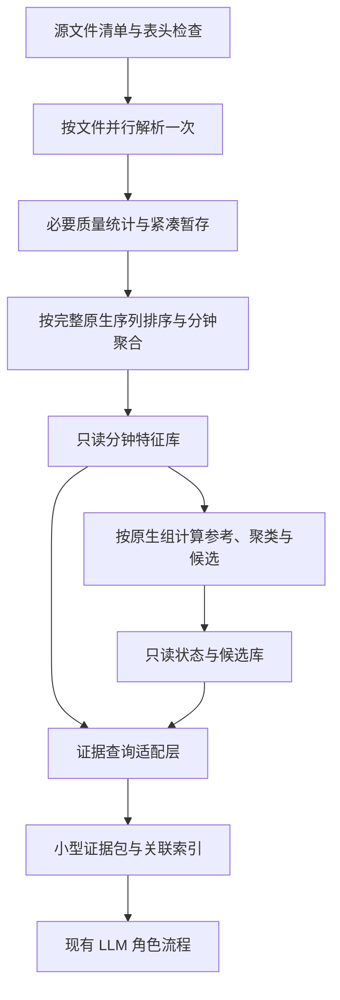

# v4 数据处理层重构设计

状态：本地实现、回归及性能对照已完成。正确性比较与最终磁盘目标通过，官方样例总耗时未达到三倍加速目标，新后端保持显式启用；实际结果见 `docs/v4-data-processing-results.md`。尚未重新启动服务器全量任务。

## 1. 目标与范围

用户要求先解决 v4 原始数据处理耗时和中间产物过大的问题，之后再讨论 LLM 和提示词。第一批全量任务与 vLLM 已停止，本轮输出已删除；原始 CSV、模型、运行环境和公开样例结果保留。

本次改造质量检查、解析、分钟特征存储、状态计算的数据访问、证据索引及缓存复用。保持“统计/聚类/规则发现候选 → LLM 确认 → 独立定位与分类 → LLM 复核 → 程序校验”的业务流程。数据库访问适配属于本次范围，角色职责、提示词、模型、候选阈值和类别规则保持当前定义。

沿用 Python 3.10+ 和标准库。数据层不依赖 GPU。服务器产物放在账号自己的 `/data/liminghang/CCF_AIOps_2026` 下，原始数据只读。目录、运行名不使用日期命名；本设计文件日期仅用于文档版本。

成功标准：数据与候选语义可核对；正常构建仅进行一次全量 CSV 解析，已登记的有限引用允许按字节范围重读校验；中间数值只保存一份；并行结果确定；中断可恢复；耗时、实际磁盘峰值和内存峰值均有实测记录。

## 2. 已有证据

- 停止前，48 个逻辑 CPU 核心的服务器上，主扫描进程约占用一个核心，GPU 未参与预处理。
- 第一批共 56 个 CSV、约 96.1 GiB，其中 NetFlow 约 89.6 GiB。
- 2 万条 NetFlow 的剖析中，列统计更新约 50 万次；解析、列统计及 JSON 编码是主要开销。剖析耗时含测量开销，不作为吞吐基准。
- 当前实验先完整 `profile_dataset`，随后 `build_features` 再次完整解析相同 CSV。原始证据取回还会扫描有关文件前缀。
- 公开第一例：604,284 行、71,208 个窗口、1 个候选事件。profile 134 秒、features 143 秒、states 63 秒、evidence 81 秒；证据数据库 273,608,704 字节，约 261 MiB。
- 窗口、matrix、states 和 evidence 数据库重复保存大量数值、维度、语义及引用。收紧候选不会消除全量窗口的重复存储。
- 用户提供的旧版全量建库耗时约两小时。尚未在相同服务器、相同输入上进行两版基准，不能据此宣布精确加速倍数。

## 3. 方案选择

| 方案 | 收益 | 代价与限制 |
|---|---|---|
| 只给现有 JSON 流程加工作进程 | 改动较小，部分阶段加速 | 保留重复解析、重复内容及昂贵原始回查，不足以解决主要问题 |
| **一次解析、紧凑特征存储、分阶段引用与并行处理** | 同时解决重复扫描、存储放大、复用与原始回查；保留标准库环境 | 需要新增存储格式，并适配状态和证据读取接口；必须验证兼容性 |
| 引入列式存储与新的批量计算依赖 | 可进一步提高扫描和分析吞吐 | 改变已约定的依赖约束，增加类型、CSV 和部署兼容工作 |

采用第二种。先通过实际基准验证标准库实现；若仍达不到性能门槛，再拿实测结果讨论是否引入列式计算依赖。

## 4. 新的数据流

文件读取可并行，所有文件仍属于一个完整批次。非 NetFlow 在完整原生序列内排序后处理；同一序列跨文件的重复时间、counter 前驱和时间间隔不能在文件边界重置。

### 4.1 必要质量统计随解析完成

生产构建使用显式 `profile_policy=essential`，同时收集文件与来源覆盖、表头、扫描/接收/拒绝行数、有效时间范围、网元映射、缺失/坏值/非有限值及质量标记。与窗口有关的重复时间、冲突和 counter 间断在排序聚合阶段计算。

生产构建不再强制计算每个原始字段的全局均值、分位数、字符串基数和近邻重复摘要。它们属于额外诊断统计，不是候选算法的参考尺度。保留现有独立全量 profile 工具；若用户主动运行该工具，额外扫描和耗时单独记录。

未计算的统计写明 `not_computed` 和策略，不能用 0、空集合或窗口分布冒充原始行分布。状态阶段仍按当前定义，使用同批次、同原生组的窗口拟合稳健参考和轻量聚类。

### 4.2 精简每行工作

每文件只建立一次表头、列位置、数值字段和语义映射。使用有界缓存处理重复的网元/城市/维度信息。复用已解析数值；不在原始行、角色统计和特征阶段反复执行字符串与浮点数往返转换。

原始内容留在 CSV。逐行只处理聚合所需字段、质量、位置及必要排序键；完整 `RawRecord` 在保留引用或原始证据查询时构造。保留外部 record_id 的现有算法，仅对实际保留/取回的引用计算完整记录 ID。

新构建以原始文件字节 SHA256 及扫描范围保证输入身份；不再为所有行额外生成 JSON 格式的 parsed-record 摘要。摘要算法和范围在 manifest 中明确区分，不能沿用旧字段名称谎称算法相同。

## 5. 存储：数值一份、状态增量、证据引用

物理上采用三个独立封存数据库，避免后续阶段写入使前一阶段的哈希失效。它们共同组成可复用数据存储，不在每个数据库中复制同一窗口内容。

| 产物 | 保存内容 | 明确不复制的内容 |
|---|---|---|
| `features/features.sqlite` | 文件、实体/原生组、字段语义字典、分钟窗口、数值统计、质量、原始引用位置 | 每个窗口不重复完整语义和维度文本 |
| `states/states.sqlite` | 每组参考与聚类模型、每窗评分/标记、候选事件及成员关系 | 不再保存完整 matrix 和窗口数值副本 |
| `evidence/evidence.sqlite` | bundle、成员/关联、上下文选择、上游路径与哈希、有限原始证据快照 | 不导入全量 states/matrices/models 副本 |

每阶段另有体积小的 manifest、summary 和 seal。完整窗口 JSONL、matrix JSONL、states JSONL 默认不再输出；提供显式导出命令用于调试和与旧实现对照，导出不成为下一阶段的必需输入。数据库引用使用相对于封存数据集根目录的位置，连同上游数据库一起移动；不得指向任意外部文件，也不能单独复制小型证据索引后宣称数据集完整。

具体表示：

- 元数据按实体、原生组、指标、语义和质量类型登记一次，以整数 ID 关联。
- 内部摘要可保存为 32 字节二进制，外部仍还原现有十六进制 ID。
- 时间以 UTC 整数微秒保存，窗口宽度和起点均可还原，不用每行重复长时间字符串。
- 数值保持 float64；计数使用整数；每个指标的统计按有版本的固定布局二进制保存，包含缺失位图。0 与缺失不能混淆。
- 未知字段、单位、质量原因及溢出标记必须可往返还原，禁止为了压缩静默删除。
- 每窗口引用最多 8 条，counter 前驱也沿用现有选择规则；同一 anchor 内容登记一次，窗口通过关系表引用。
- 原始物化仅限已选证据引用，不能把它标为全量原始快照。

窗口数值和语义只从特征库读取，`window_vector` 所需投影按需计算。状态查询适配层批量获取数值与引用，避免逐窗 N+1 次 SQL 查询。对 LLM 返回的结构、数值含义、查询过滤、排序与分页保持现有契约。

## 6. 排序、并行与中断恢复

### 6.1 文件解析

默认 4 个工作进程，可配置 1–8 个；按文件大小调度任务。每个进程写自己的暂存库，不并发写共享 SQLite。文件 ID 和合并顺序依据既有 `(source, relative_path)` 顺序确定，不能由任务完成顺序决定。

NetFlow 使用分钟/网元/接口/协议的有界汇总，不把每条五元组写入全局排序表。保留数量和、有效/坏值计数、均值/方差、首末值、时间覆盖及最早引用的当前定义；仍不计算该流式模式已声明未计算的逐流分位数和变化次数。

非 NetFlow 写精简排序记录。按完整原生组分配聚合任务，统一排序跨文件记录。同时间的顺序保持来源文件顺序及 record_index，确定分位数采样、首末值和引用选择；FRR 多行文本本身通过原始位置取回。

### 6.2 状态计算

不同原生组可以并行计算，同组顺序固定。保持当前同批次参考范围、采样容量、聚类种子、阈值、规则与候选准入策略。候选关联与跨城市查询基于合并后的完整批次，不把各城市变成独立实验。

合并结果由单一写入者批量写入数据库；只保留查询需要的索引，主要索引在批量导入后建立。各并行阶段错开执行，进程数量与内存预算不叠加失控。

### 6.3 检查点

文件读取每 100,000 条记录或 30 秒提交一次检查点，取较早触发者，但只能在完整 CSV 记录边界提交。位置、行号、已完成计数、暂存数据和 NetFlow 累积状态在同一事务内提交。

恢复从检查点后的字节边界继续，不能重复加入已提交记录。原始内容摘要需要恢复时，允许快速重读已处理字节计算摘要；不能重新解析已完成行。每组聚合和状态计算也登记完成状态，未完成组丢弃自身暂存后重做。

只有全输入范围完成、数量对应、引用完整且版本匹配，才能封存发布。失败保留可校验检查点，已完成暂存仅在下游成功封存后回收。不能修改旧 checkpoint 绕过校验。

## 7. 原始证据直接定位

在首次解析时，为保留的引用登记 `file_id`、`record_index`、`line_start/line_end`、`byte_start/byte_length` 及内容 ID。字节偏移对应完整 CSV 逻辑记录的起止，不能把物理行号当作字节位置。

读取器必须处理 UTF-8/BOM、LF/CRLF/CR、空行、引号内换行、Unicode 和长日志。一个文件的表头登记一次；取回引用时读取完整范围、按同一 CSV 规则解析，再验证现有 record_id 与来源字段。无法验证时明确失败，不退回到从头扫描掩盖索引错误。

只能查询已登记引用。读取前后检查源文件身份和大小/mtime，取回记录验证内容 ID；复用完整数据层前，按 manifest 的原始字节摘要验证输入。路径仍限制在登记的只读 raw_root 内。

直接定位索引只覆盖被保留的引用，不为每条 NetFlow 保存一份完整原始记录或逐行索引。源 CSV 仍是证据的一部分，不能在建库后自动删除。

## 8. 复用与完整性

各层分别保存自身格式、生产代码摘要、配置摘要、上游摘要和输入范围。全运行代码指纹继续用于审计，但不能用整个项目指纹作为每层复用的唯一条件。

| 变化 | 重新计算范围 |
|---|---|
| 原始输入、解析语义、身份映射、时区、窗口宽度或 counter 规则 | 特征及其下游 |
| 参考范围、聚类、候选阈值或准入规则 | 状态及证据；复用特征 |
| 证据关联、上下文选择或拓扑 | 证据；复用特征与状态 |
| 模型、角色提示词或诊断预算 | 后续模型实验；复用兼容且封存的数据层 |

生产代码摘要覆盖该层实际依赖的代码与配置，不只比较人工版本号。源生产版本与当前消费版本分别记录。只在格式兼容、契约匹配、输入与产物校验通过时复用；第一批/第二批、全量/前缀样本分别隔离。新数据库摘要使用新名称与算法版本，不能把数据库文件哈希塞入旧 `input_windows_sha256` 字段冒充原窗口 JSONL 摘要；数据访问适配层负责旧/新格式的来源说明与校验。

前缀样本写 `complete=false`，摘要只覆盖其实际读取范围，不能声明完整文件字节 SHA256。恢复记录与可复用产物分开登记，半成品不能成为模型输入。

## 9. 验收顺序与量化标准

### 正确性先验收

1. 固定改造前的实际源代码和配置作为对照，不能只使用 Git HEAD：当前还有未提交的既有修复。
2. 检查三份官方样例及合成边界输入。窗口/group/事件 ID、原始引用、整数计数、质量/缺失标记、排序、分页和候选成员应一致；有限浮点统计按 `rel_tol=1e-10, abs_tol=1e-12` 比较，缺失与非有限值单独比较。
3. 并行与单进程结果确定。跨文件 counter、重叠/乱序、重复时间冲突、辅助身份、路由 peer、长日志、原始文件修改和恶意路径均须覆盖。
4. NetFlow 并行合并可能改变浮点运算次序，必须逐项验证；任何阈值附近差异引起候选改变，都不能通过等价验收。需要改进排序/累积算法或明确另行讨论算法变化。
5. 使用相同封存数据比较查询返回及所有角色输入准备结果；仅对合同允许的运行路径/生产摘要等来源字段作对应转换，不忽略数值、引用、范围和质量差异。
6. 验证中断恢复、磁盘预留、空间上限、工作进程失败及输入变化；失败不能发布 completed，也不能删除原始文件、模型或旧实验。

本轮不调用 LLM，不调整提示词。公开真值仅用于已有规则对照/评测验证，不能参与解析、聚合和候选拟合。三个样例只能检查回归，不能证明隐藏集准确率。

### 性能和容量再验收

- 同服务器、相同输入/配置分别测旧/新路径；记录进程数、CPU 时间、墙钟、读取字节、行/秒、各阶段窗口数、RSS、最终及峰值磁盘字节。
- 三个样例的无模型预处理总耗时目标不超过旧实现的 1/3；最终中间产物目标不超过旧实现的 30%。交替运行各三次取中位数，报告文件缓存和共享服务器负载情况，不人为清空系统缓存。
- 另外测试至少 1,000,000 条 NetFlow 记录，并包含非 NetFlow 与跨文件连续序列；前缀性能样本不能用于推断故障分数或冒充全量。
- 总内存预算默认 4 GiB，进程和缓存容量共同受预算约束；磁盘预留默认 12 GiB，新增 `max_workspace_gib` 约束本轮持久产物、暂存、排序与 SQLite 日志的总占用，首轮设 100 GiB。触及预算保留检查点并停止，不自动删除输入。
- 第一批特征建库约两小时、全部无模型预处理约四小时、最终中间产物 30–60 GiB、峰值不超过 100 GiB，均为优化目标，尚未测得。按真实行数、窗口数及分来源吞吐更新预测，不能只按三个样例的时长比例外推。
- 正确性、直接定位、复用/恢复与小范围性能门槛通过后，再讨论启动第一批全量数据层任务。LLM 与 prompt 优化安排在数据层验收之后。

## 10. 交付边界

后续实施应分成可独立验收的三个交付：一次解析与原始位置索引；紧凑特征库与确定性并行聚合；状态/证据引用适配、复用与恢复。每步提供对照数据和性能记录，保留旧读取路径用于兼容已封存实验，不改写旧产物。

新的写入格式使用独立版本与新输出目录。只有验收通过后，才将新数据后端设为完整实验的默认入口。服务器保持停止状态，部署与全量执行另行安排。本文不授权上传 GitHub 或提交比赛结果。
