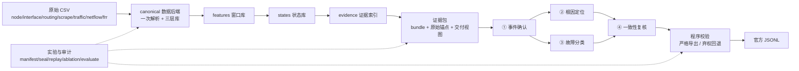

# CCF AIOps 2026 · v4 汇报

## 1. 概括

v4 是一条可复用数据层 + 状态发现 + 证据索引 + 同一 LLM 四角色诊断 + 程序校验与封存的混合流水线：

1. 原始多源观测只解析一次，落成可复用的特征库/状态库/证据库三层 SQLite；
2. 统计、聚类、规则三类线索共同产生候选窗口，程序合并为事件；
3. 事件被组织成带原始证据定位的证据包（bundle）；
4. 同一个本地 LLM 以四个独立角色（确认、定位、分类、复核）读取证据、调用只读工具并给出结构化结论；
5. 每一步都有程序化证据校验，通过后导出官方 JSONL；所有阶段产物带哈希封存，可审计、可重放。

---

## 2. 总体架构

### 分层职责

| 层 | 目录 | 职责 |
|---|---|---|
| 数据接入 | `aiops_common/data/` | 七类 CSV 的发现、读取、时间与网元标准化、计数器差分、流式观测 |
| 数据后端 | `aiops_v4/data/` | canonical 三层库构建、增量/复用、缓存与封存、字节定位、SQLite 运行时调优 |
| 特征层 | `aiops_v4/features/` | 分钟级窗口、node/edge/log 多视图特征、语义与单位、计数器处理、流式 netflow |
| 状态层 | `aiops_v4/states/` | 稳健统计、轻量聚类、规则线索、候选准入、事件合并、参考与紧凑投影 |
| 证据层 | `aiops_v4/evidence/` | bundle 划分、成员关系、原始锚点、证据索引、交付视图、查询工具 |
| 角色层 | `aiops_v4/agents/` | 共享 LLM 后端、wire 压缩、结构化工具协议、四角色、校验器、导出、运行管线 |
| 实验层 | `aiops_v4/experiments/` | 封存运行、消融、官方评测、比较、成本与用量记录 |
| 公共契约 | `aiops_challenge_2026/` | 官方网元/类别配置、JSONL schema、官方评测器复用 |
| 配置与脚本 | `configs/v4/`、`scripts/` | 数据构建、四角色运行、公开样例、加速写库、数据基准 |

## 3. 端到端流程

### 3.1 原始数据

- 七类来源：`node`（节点资源）、`interface`（接口流量/错误）、`routing`（BGP/OSPFv3/路由表）、`scrape`（采集健康）、`traffic`（业务探针）、`netflow`（5-tuple 分钟流）、`frr`（进程日志）。
- 三批数据的来源集合不同：第一批七类齐全；第二批、第三批只有 node/interface/routing/scrape/netflow（无 traffic、无 frr），这是批次数据本身的设计。
- 解析时保留原始字段、时间、网元标识与物理位置，并记录质量标记（缺失、乱序、单位未知、网元未映射等）。

### 3.2 canonical 数据后端（一次解析，三层复用）

`python -m aiops_v4.data build --config ... --output-dir ... --progress`

1. 一次解析原始 CSV，生成 `features_<hash>/` 窗口库；
2. 由窗口库生成 `states_<hash>/` 状态库；
3. 由状态库生成 `evidence_<hash>/` 证据索引。

关键机制：

- **层签名**：`format + producer 哈希 + 配置子集 + 上游层哈希` 决定目录名；配置或代码变化会生成新层，不会误用旧层。
- **封存**：每层发布 `summary.json` + `seal.json`，记录产物清单、依赖、输入范围、SHA；消费前复验。
- **复用**：`--resume` 复用已封存层；生产期间有独占锁，避免同目录并发。
- **字节定位**：原始记录以 `(file, byte range)` 形式登记锚点；需要时可回读原文并校验哈希，支撑“引用必须可追溯”。
- **linked 视图**：证据库通过 SQLite view 关联状态库/特征库，查询时按需读取，不复制大表。
- **资源预算**：内存、工作区、磁盘余量有显式上限；超限时保留 checkpoint 并以 `WorkspaceBudgetError` 退出，不发布半成品。
- **加速写库**：`scripts/v4_fast_writer.py` 把未封存的特征/状态库临时写到快速盘，完成后原子发布回数据目录，保留 WAL/FULL 持久性。

### 3.3 窗口特征层

- 分钟级窗口，保留连续时间轴与观测掩码；`node` 视图（80 网元 × 39 特征）、`edge` 视图（64 条关系 × 24 特征）、`log` 视图；
- 维度侧车（interface/routing/scrape）保存按接口、peer、prefix、协议等维度展开的序列；
- 特征带单位与语义状态（identity/log1p/counter 差分等）；计数器做无回落/无缺口的有效增量；
- 窗口层不默认做“健康/故障”判断，只提供可比较的观测。

### 3.4 状态层（发现运行状态）

- **三类线索**：
  - 统计：逐列中位数/MAD 的稳健 z 分数 + 最小尺度下限 + 绝对门槛；
  - 聚类：每批次轻量聚类（medoid/距离/参考支持度），簇是运行状态不是故障标签；
  - 规则：资源压力、接口丢包/错误、协议状态、路由变化、采集不可用等。
- **候选准入**：`conservative` 策略要求线索有佐证（规则信号、直接机制、聚类证据等）且满足最小窗口数，才进入候选；被抑制的窗口保留 `suppression_reason` 可查。
- **参考策略**：离线同批参考（`known_healthy=false`），只能称“相对参考偏离”，不能说“已知健康”。
- **事件**：相邻候选窗口按时间合并成事件；事件起止由程序计算；状态库同时保留原始候选窗口与合并后事件。
- **状态投影**：状态行含 `candidate/raw_candidate/suppression_reason/scoring_status/quality/rule_signals/dimensions/triggers/stat_score/cluster_*/drivers/coverage/reference_status` 等字段，供证据与角色使用。

### 3.5 证据层（把状态变成可交付的证据包）

- **bundle**：按“同实体、时间重叠”把候选窗口组织成证据包；包内包含候选窗清单、支持观测、无当前触发观测、质量上下文、关系、原始锚点。
- **交付视图**：`a1-readable-1` 等初始交付 profile 控制角色首轮看到的证据形状（紧凑观测、计数器检查、同组前后对照、同城候选设备、端点关联），原始全量状态与原文仍可按需查询。
- **原始证据**：`raw_scope=selected_packet_anchors_only`，包内引用的原始记录被物化到证据库；未物化的锚点保留登记与物理定位，可按需回读。
- **查询工具**：`query_states`、`query_members`、`query_model`、`query_relations`、`query_raw` + 分块 `read_chunk`；全部只读、批次/范围受限、分页返回、引用必须完整取回后才可使用。

### 3.6 LLM 四角色

同一模型（当前运行使用 `Qwen/Qwen3-8B-AWQ`），四个独立会话，互不读取对方结论（复核除外）：

| 角色 | 输入 | 任务 | 程序校验 |
|---|---|---|---|
| ① 事件确认 | bundle 候选窗清单、紧凑观测、同组对照、同城候选 | 判断真实故障/正常/证据不足；按观测时间连通组件分组；确认需本组 state/raw 支持 | 全部窗口恰好分配一次；组内连续；事件起止由程序计算；confirmed 必须有本组支持 |
| ② 根因定位 | 确认事件 + 证据 + 候选设备观测 | 对候选设备逐一评分并给首选；首选固定第 1，其余按置信度排序 | 网元官方 ID/唯一；每候选必须引用本设备观测；首选必须在评分表内 |
| ③ 故障分类 | 同一确认事件 + 证据（不读定位） | 在官方 major/sub 枚举内选择；无法区分则 deferred | 类别必须是官方配对；至少一条本次事件窗口支持 |
| ④ 一致性复核 | 事件、定位结果、分类结果、证据 | 分别核验 root_check 与 category_check，给出 accept/reject/defer | proof 必须属于首选设备；accept 需根因与类别均 supported 且 contradictions 为空 |

角色协议要点：

- **函数调用式结构化输出**：每个角色通过 `submit_role_result` 提交参数，schema 由程序按当前事件生成；
- **协议族**：`simple-v1/v2`（确认/交付格式）与 `ranked5-v1/v3/v4`（定位/复核的五候选协议）；当前运行使用 `simple-v2 + ranked5-v4`；
- **evidence-first 字段序**：窗口/支持/机制/反证/缺失/结论按固定顺序输出，模型先列证据再下结论；
- **wire 压缩**：请求在传输前做无损别名/表压缩（`v4-evidence-wire-1/2/3`），模型输出先还原成真实 ID 再校验；
- **预算**：单角色最多 6 轮、12 次工具调用、2 轮查询；prompt 上限 16 万字符，单次生成上限 2048 tokens；温度 0；
- **失败语义**：超时、非法 JSON、非法引用、预算耗尽等都会让该角色 `deferred`，不伪造结论；程序记录 `error_code` 与完整 trace。

### 3.7 复核与导出

- 定位与分类都 resolved 才进入复核；复核 accept → 严格导出。
- **严格导出**会重放角色 trace，核对模型、后端、初始请求、工具调用数、证据引用是否与运行时一致，再按官方格式生成预测。
- **证据先验**：导出层用已交付的 `drivers/rule_signals/feature_values/dimensions` 计算“最强机制”。若模型类别与证据机制不一致，导出时纠正并记录 `category_adjustment`（原值/纠正值/依据）。
- **弃权回退**：已确认事件若定位或分类至少一方 resolved，用已交付证据补齐另一方后导出；两侧都弃权或复核 reject 时不导出。导出的预测记录 `export_basis`、`fallback` 供审计。
- **官方格式**：导出文件字段恰好 `prediction_id/start_time/end_time/root_cause_top5/fault_category`；时间 UTC 毫秒 `+00:00`；root_cause_top5 统一 5 个、rank 连续、网元官方唯一；类别官方配对；按时间排序并全局编号。

### 3.8 实验、审计与可复现

- **封存运行**：每次运行登记 config、知识卡、代码 SHA、输入/输出 SHA、证据包与角色 trace；阶段产物先写临时目录，成功后硬链接发布，失败不覆盖。
- **可重放**：`ReplayBackend` 可从记录的角色请求/响应完整重放；冻结快照可独立校验模型、提示词、工具调用和证据交付。
- **消融**：`statistics_only / cluster_only / no_rules / joint_roles / program_review / no_knowledge / with_state_explanation / discovery_only` 等变体各自独立重跑数据与证据，不共享可变缓存。
- **评测**：`python -m aiops_v4.experiments evaluate --run-dir ... --ground-truth ...` 复用官方评分实现；比较命令会校验两个 evaluation 的封存摘要与真值 SHA。
- **成本**：记录每次调用的 prompt/completion token、真实/模拟标记、失败与重试；只有提供报价且 token 完整时才计算费用估计。

---

## 4. 实验结果

### 4.1 数据层构建结果

三批原始数据均通过 canonical 后端一次解析，生成特征/状态/证据三层；下表为实际扫描范围与层规模。

| 批次 | 原始行数 | 原始数据量 | 窗口/状态数 | 参与四角色的工作单元 | 层产物 |
|---|---:|---:|---:|---:|---|
| 第一批 | 521,491,569 | 97 GB | 60,590,967 | 830（原始 1502 个 bundle 经同目标合并） | features `9db1a9f3` / states `60d8901f` / evidence `a1_full` |
| 第二批 | 246,182,775 | 41 GB | 29,026,134 | 175 | features `a20d55e8` / states `270e3ca9` / evidence `ranked5_v4` |
| 第三批 | 493,887,335 | 88.9 GB | 58,356,718 | 297 | features `5eda72da`（23.2 GB）/ states `cf95f488`（18.8 GB）/ evidence `6f3ae15f` |

第三批建库实测：24 worker 下特征层约 4 小时、状态层 73.5 分钟、证据层约 2 分钟；中断后恢复时复用已封存层（特征校验 8.5 分钟、状态校验 2.4 分钟、证据重建 2 分钟）。建库是一次性离线过程，不进入线上评分路径。

### 4.2 四角色运行结果

| 批次 | 证据包 | 确认 / 待判 / 拒绝（assessment） | 诊断接受 / 拒绝 / 待判 | 预测 | 其中弃权回退 | 角色失败 / 运行 | 模型调用 | 墙钟时间 |
|---|---:|---:|---:|---:|---:|---:|---:|---:|
| 第一批 | 830 | 402 / 68 / 3 | 266 / 28 / 108 | 370 | 104 | 448 / 1,964（22.8%） | 4,758 | 5 小时 33 分 |
| 第二批 | 175 | 130 / 38 / 7 | 68 / 6 / 56 | 124 | 56 | 51 / 535（9.5%） | 1,542 | 1 小时 31 分 |
| 第三批 | 297 | 204 / 81 / 9 | 124 / 11 / 69 | 188 | 64 | 60 / 852（7.0%） | 2,525 | 2 小时 41 分 |
| **合计** | **1,302** | **736 / 187 / 19** | **458 / 45 / 233** | **682** | **224（32.8%）** | **559 / 3,351（16.7%）** | **8,825** | **约 9 小时 45 分** |

说明：

- 三批使用同一套配置：`Qwen/Qwen3-8B-AWQ`、2 个 vLLM 端点（TP=2）、4 个分片、`simple-v2 + ranked5-v4` 协议、`v4-evidence-wire-3`、温度 0、单次生成上限 2048 tokens，未开启 state_explanation。
- 角色失败全部按 deferred 处理，不产生伪造结论；主要原因是提示词预算（第一批 420 次、第二批 24 次、第三批 11 次，集中在候选窗口特别多的大 bundle 的确认角色）和模型返回不完整（28 / 27 / 49 次）。
- 弃权回退 224 条：已确认事件中一方角色 resolved、另一方弃权时，用已交付证据补齐后导出，并记录 `export_basis`。
- token 用量：prompt 约 2.147 亿，completion 约 200 万。

### 4.3 预测输出与格式合规

- 三批预测：370 + 124 + 188 = **682 条**；其中严格导出 458 条、弃权回退 224 条。
- 字段恰好 `prediction_id / start_time / end_time / root_cause_top5 / fault_category`；时间统一 UTC 毫秒 `+00:00`；`root_cause_top5` 全部 5 个、rank 1–5 连续、网元官方唯一；类别为官方配对；按时间排序、全局编号。
- 独立复检（官方 schema 逐条校验 + 字段/时间/rank/网元/类别/唯一性检查）：**0 条不合规**。
- 最终文件：`outputs/v4/rerun_20261017/final_submission.jsonl`，SHA-256 `25cf0e3ddfa7c3236446e69b1e8e8c26d91ea4f8d87331ea6bf0440d6fdb482e`。
- 类别分布（682 条）：

| 类别 | 数量 | 类别 | 数量 |
|---|---:|---|---:|
| resource/cpu_pressure | 383 | service/web_5xx | 57 |
| routing/bgp_session_down | 67 | resource/disk_io_pressure | 60 |
| service/auth_error | 27 | link/loss | 25 |
| routing/ospf6_cost_anomaly | 20 | service/web_slow | 17 |
| service/dns_down | 17 | routing/ospf6_neighbor_down | 4 |
| routing/blackhole | 2 | resource/disk_space_low | 2 |
| routing/wrong_static_route | 1 | | |

### 4.4 离线评测（公开样例）

三个公开样例（开发样例，非独立验证集）上的本地重评：

| 方案 | Total | AD | RCA | Major | Minor | TP / FP / FN |
|---|---:|---:|---:|---:|---:|---|
| v4 四角色 | 86.64 | 33.31 | 40.0 | 10.0 | 3.33 | 3 / 1 / 0 |
| v4 规则对照（同一候选） | 93.31 | 33.31 | 40.0 | 10.0 | 10.0 | 3 / 1 / 0 |
| v3 规则回归 | 96.01 | 36.01 | 40.0 | 10.0 | 10.0 | 3 / 0 / 0 |

说明：三个公开样例在开发过程中被多次使用，不能作为独立泛化证据；样例分与隐藏集分数不可直接比较。

### 4.5 平台评测（隐藏集）

| 提交 | 批次范围 | 平台反馈 |
|---|---|---:|
| v3 规则（395 + 173） | 三批 | 33.11 / 100 |
| v3 规则（前两批合并） | 第一批 + 第二批 | 22.79 / 60 |
| v4（上一轮运行） | 第一批 + 第二批 | 12.07 / 60 |
| v4（本轮运行） | 三批 | 19.43 / 100 |

说明：隐藏标签不可见；第二批起平台只返回总分，不返回 AD/RCA/大类/小类分项；以上为团队提交记录，不能在本地复现。

### 4.6 运行产物

- 每批产出：`merged_<batch>.jsonl`（合并）、`official_<batch>.jsonl`（官方格式）、`official_<batch>.report.json`（校验报告）。
- 三批合并：`final_submission.jsonl`。
- 诊断与角色 trace：`runs/<batch>/shard_*/` 下的 `bundles.jsonl / roles.jsonl / diagnoses.jsonl / predictions.jsonl / summary.json`，含各阶段 SHA。
- 中间批次文件（`merged_*`）与最终文件分离保存，最终提交只使用官方格式文件。
