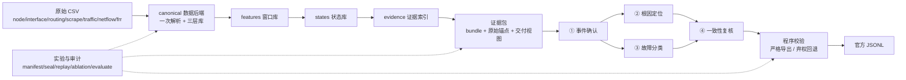

# CCF AIOps 2026 · v4 系统架构与流程汇报

> 范围：本报告只描述当前 `v4` 分支的实际实现与运行方式，不包含后续改进计划。
> 版本：服务器仓库 `v4` 分支，`5751749`（含 `bfd4221`、`56d865a`、`beb28bf` 三次诊断/导出层提交）。
> 代码规模：`aiops_v4` 及相关模块约 1.4 万行 Python；`tests/v4` 86 个测试文件。

---

## 1. 一句话概括

v4 是一条**可复用数据层 + 状态发现 + 证据索引 + 同一 LLM 四角色诊断 + 程序校验与封存**的混合流水线：

1. 原始多源观测只解析一次，落成可复用的**特征库/状态库/证据库**三层 SQLite；
2. 统计、聚类、规则三类线索共同产生**候选窗口**，程序合并为事件；
3. 事件被组织成带原始证据定位的**证据包（bundle）**；
4. 同一个本地 LLM 以**四个独立角色**（确认、定位、分类、复核）读取证据、调用只读工具并给出结构化结论；
5. 每一步都有**程序化证据校验**，通过后导出官方 JSONL；所有阶段产物带哈希封存，可审计、可重放。

---

## 2. 总体架构



### 2.1 分层职责

| 层 | 目录 | 职责 |
|---|---|---|
| 数据接入 | `aiops_common/data/` | 七类 CSV 的发现、读取、时间与网元标准化、计数器差分、流式观测 |
| 数据后端 | `aiops_v4/data/` | canonical 三层库构建、增量/复用、缓存与封存、字节定位、SQLite 运行时调优 |
| 特征层 | `aiops_v4/features/` | 分钟级窗口、node/edge/log 多视图特征、语义与单位、计数器处理、流式 netflow |
| 状态层 | `aiops_v4/states/` | 稳健统计、轻量聚类、规则线索、候选准入、事件合并、参考与紧凑投影 |
| 证据层 | `aiops_v4/evidence/` | bundle 划分、成员关系、原始锚点、证据索引、交付视图、查询工具 |
| 角色层 | `aiops_v4/agents/` | 共享 LLM 后端、wire 压缩、结构化工具协议、四角色、校验器、导出、运行管线 |
| 实验层 | `aiops_v4/experiments/` | 封存运行、消融、官方评测、比较、成本与用量记录 |
| 公共契约 | `aiops_challenge_2026/` | 官方网元/类别配置、JSONL schema、官方评测器复用 |
| 配置与脚本 | `configs/v4/`、`scripts/` | 数据构建、四角色运行、公开样例、加速写库、数据基准 |

### 2.2 代码规模

| 模块 | 文件数 | 行数 |
|---|---:|---:|
| `aiops_v4/data` | 18 | 1,778 |
| `aiops_v4/features` | 19 | 3,397 |
| `aiops_v4/states` | 15 | 1,922 |
| `aiops_v4/evidence` | 9 | 1,014 |
| `aiops_v4/agents` | 17 | 3,374 |
| `aiops_v4/experiments` | 10 | 1,003 |

---

## 3. 端到端流程

### 3.1 原始数据

- 七类来源：`node`（节点资源）、`interface`（接口流量/错误）、`routing`（BGP/OSPFv3/路由表）、`scrape`（采集健康）、`traffic`（业务探针）、`netflow`（5-tuple 分钟流）、`frr`（进程日志）。
- 三批数据的来源集合不同：第一批七类齐全；第二批、第三批只有 node/interface/routing/scrape/netflow（无 traffic、无 frr），这是批次数据本身的设计。
- 解析时保留原始字段、时间、网元标识与物理位置，并记录质量标记（缺失、乱序、单位未知、网元未映射等）。

### 3.2 canonical 数据后端（一次解析，三层复用）

`python -m aiops_v4.data build --config ... --output-dir ... --progress`

1. **一次解析**原始 CSV，生成 `features_<hash>/` 窗口库；
2. 由窗口库生成 `states_<hash>/` 状态库；
3. 由状态库生成 `evidence_<hash>/` 证据索引。

关键机制：

- **层签名**：`format + producer 哈希 + 配置子集 + 上游层哈希` 决定目录名；配置或代码变化会生成新层，不会误用旧层。
- **封存**：每层发布 `summary.json` + `seal.json`，记录产物清单、依赖、输入范围、SHA；消费前复验。
- **复用**：`--resume` 复用已封存层；生产期间有独占锁，避免同目录并发。
- **字节定位**：原始记录以 `(file, byte range)` 形式登记锚点；需要时可回读原文并校验哈希，支撑“引用必须可追溯”。
- **linked 视图**：证据库通过 SQLite view 关联状态库/特征库，查询时按需读取，不复制大表。
- **资源预算**：内存、工作区、磁盘余量有显式上限；超限时保留 checkpoint 并以 `WorkspaceBudgetError` 退出，不发布半成品。
- **加速写库**：`scripts/v4_fast_writer.py` 把未封存的特征/状态库临时写到快速盘，完成后原子发布回数据目录，保留 WAL/FULL 持久性。

### 3.3 窗口特征层

- 分钟级窗口，保留连续时间轴与观测掩码；`node` 视图（80 网元 × 39 特征）、`edge` 视图（64 条关系 × 24 特征）、`log` 视图；
- 维度侧车（interface/routing/scrape）保存按接口、peer、prefix、协议等维度展开的序列；
- 特征带单位与语义状态（identity/log1p/counter 差分等）；计数器做无回落/无缺口的有效增量；
- 窗口层不默认做“健康/故障”判断，只提供可比较的观测。

### 3.4 状态层（发现运行状态）

- **三类线索**：
  - 统计：逐列中位数/MAD 的稳健 z 分数 + 最小尺度下限 + 绝对门槛；
  - 聚类：每批次轻量聚类（medoid/距离/参考支持度），簇是运行状态不是故障标签；
  - 规则：资源压力、接口丢包/错误、协议状态、路由变化、采集不可用等。
- **候选准入**：`conservative` 策略要求线索有佐证（规则信号、直接机制、聚类证据等）且满足最小窗口数，才进入候选；被抑制的窗口保留 `suppression_reason` 可查。
- **参考策略**：离线同批参考（`known_healthy=false`），只能称“相对参考偏离”，不能说“已知健康”。
- **事件**：相邻候选窗口按时间合并成事件；事件起止由程序计算；状态库同时保留原始候选窗口与合并后事件。
- **状态投影**：状态行含 `candidate/raw_candidate/suppression_reason/scoring_status/quality/rule_signals/dimensions/triggers/stat_score/cluster_*/drivers/coverage/reference_status` 等字段，供证据与角色使用。

### 3.5 证据层（把状态变成可交付的证据包）

- **bundle**：按“同实体、时间重叠”把候选窗口组织成证据包；包内包含候选窗清单、支持观测、无当前触发观测、质量上下文、关系、原始锚点。
- **交付视图**：`a1-readable-1` 等初始交付 profile 控制角色首轮看到的证据形状（紧凑观测、计数器检查、同组前后对照、同城候选设备、端点关联），原始全量状态与原文仍可按需查询。
- **原始证据**：`raw_scope=selected_packet_anchors_only`，包内引用的原始记录被物化到证据库；未物化的锚点保留登记与物理定位，可按需回读。
- **查询工具**：`query_states`、`query_members`、`query_model`、`query_relations`、`query_raw` + 分块 `read_chunk`；全部只读、批次/范围受限、分页返回、引用必须完整取回后才可使用。
- 三批实际规模：

| 批次 | 原始行数 | 窗口/状态数 | 工作单元（参与四角色的 bundle） |
|---|---:|---:|---:|
| 第一批 stage1 | 521,491,569 | 60,590,967 | 830 |
| 第二批 stage2 | 246,182,775 | 29,026,134 | 175 |
| 第三批 stage3 | 493,887,335 | 58,356,718 | 297 |

### 3.6 LLM 四角色

同一模型（当前运行使用 `Qwen/Qwen3-8B-AWQ`），四个**独立会话**，互不读取对方结论（复核除外）：

| 角色 | 输入 | 任务 | 程序校验 |
|---|---|---|---|
| ① 事件确认 | bundle 候选窗清单、紧凑观测、同组对照、同城候选 | 判断真实故障/正常/证据不足；按观测时间连通组件分组；确认需本组 state/raw 支持 | 全部窗口恰好分配一次；组内连续；事件起止由程序计算；confirmed 必须有本组支持 |
| ② 根因定位 | 确认事件 + 证据 + 候选设备观测 | 对候选设备逐一评分并给首选；首选固定第 1，其余按置信度排序 | 网元官方 ID/唯一；每候选必须引用本设备观测；首选必须在评分表内 |
| ③ 故障分类 | 同一确认事件 + 证据（不读定位） | 在官方 major/sub 枚举内选择；无法区分则 deferred | 类别必须是官方配对；至少一条本次事件窗口支持 |
| ④ 一致性复核 | 事件、定位结果、分类结果、证据 | 分别核验 root_check 与 category_check，给出 accept/reject/defer | proof 必须属于首选设备；accept 需根因与类别均 supported 且 contradictions 为空 |

角色协议要点：

- **函数调用式结构化输出**：每个角色通过 `submit_role_result` 提交参数，schema 由程序按当前事件生成；
- **协议族**：`simple-v1/v2`（确认/交付格式）与 `ranked5-v1/v3/v4`（定位/复核的五候选协议）；当前运行使用 `simple-v2 + ranked5-v4`；
- **evidence-first 字段序**：窗口/支持/机制/反证/缺失/结论按固定顺序输出，模型先列证据再下结论；
- **wire 压缩**：请求在传输前做无损别名/表压缩（`v4-evidence-wire-1/2/3`），模型输出先还原成真实 ID 再校验；
- **预算**：单角色最多 6 轮、12 次工具调用、2 轮查询；prompt 上限 16 万字符，单次生成上限 2048 tokens；温度 0；
- **失败语义**：超时、非法 JSON、非法引用、预算耗尽等都会让该角色 `deferred`，不伪造结论；程序记录 `error_code` 与完整 trace。

### 3.7 复核与导出

- 定位与分类都 resolved 才进入复核；复核 accept → 严格导出。
- **严格导出**会重放角色 trace，核对模型、后端、初始请求、工具调用数、证据引用是否与运行时一致，再按官方格式生成预测。
- **证据先验**：导出层用已交付的 `drivers/rule_signals/feature_values/dimensions` 计算“最强机制”。若模型类别与证据机制不一致，导出时纠正并记录 `category_adjustment`（原值/纠正值/依据）。
- **弃权回退**：已确认事件若定位或分类至少一方 resolved，用已交付证据补齐另一方后导出；两侧都弃权或复核 reject 时不导出。导出的预测记录 `export_basis`、`fallback` 供审计。
- **官方格式**：导出文件字段恰好 `prediction_id/start_time/end_time/root_cause_top5/fault_category`；时间 UTC 毫秒 `+00:00`；root_cause_top5 统一 5 个、rank 连续、网元官方唯一；类别官方配对；按时间排序并全局编号。

### 3.8 实验、审计与可复现

- **封存运行**：每次运行登记 config、知识卡、代码 SHA、输入/输出 SHA、证据包与角色 trace；阶段产物先写临时目录，成功后硬链接发布，失败不覆盖。
- **可重放**：`ReplayBackend` 可从记录的角色请求/响应完整重放；冻结快照可独立校验模型、提示词、工具调用和证据交付。
- **消融**：`statistics_only / cluster_only / no_rules / joint_roles / program_review / no_knowledge / with_state_explanation / discovery_only` 等变体各自独立重跑数据与证据，不共享可变缓存。
- **评测**：`python -m aiops_v4.experiments evaluate --run-dir ... --ground-truth ...` 复用官方评分实现；比较命令会校验两个 evaluation 的封存摘要与真值 SHA。
- **成本**：记录每次调用的 prompt/completion token、真实/模拟标记、失败与重试；只有提供报价且 token 完整时才计算费用估计。

---

## 4. 关键机制小结

### 4.1 证据契约

- 引用只允许使用**实际交付给该角色**的 state/raw/event/relation；程序维护 `seen` 注册表；
- 原始日志和 CSV 文本被视为不可信数据，其中的指令不执行；
- 统计异常、聚类、规则只是线索，不能直接当故障标签；参考不是已知健康；
- 缺失/未触发/质量差不能当作“正常证据”；支持与反证必须可追溯。

### 4.2 失败语义

| 情况 | 结果 |
|---|---|
| 证据不足/无法区分 | 角色 `deferred`，记录 `missing_evidence` |
| 模型输出非法/引用未见证据 | 角色 `deferred`，记录 `error_code` 与 trace |
| 复核 reject | 该事件不导出 |
| 复核 defer | 可按策略导出（记录 `export_basis`），或保留为未导出诊断 |
| 一侧角色弃权、另一侧 resolved | 用证据先验补齐后导出（记录 fallback） |
| 向量数/预算耗尽 | 记录未完成状态，不发布成功摘要 |

### 4.3 当前三批运行产物

- 运行目录：`outputs/v4/rerun_20261017/`
- 四个分片/批；每批产出 `merged_<batch>.jsonl`、`official_<batch>.jsonl`、`official_<batch>.report.json`
- 三批合并：`final_submission.jsonl`，682 条（370 + 124 + 188）
- 格式独立复核：0 条不合规；全部 5 根因；时间、rank、网元、类别、唯一 ID 均通过官方 schema
- 诊断与角色 trace 保留在 `runs/<batch>/shard_*/`，含 `bundles/roles/diagnoses/predictions/summary` 与 SHA

---

## 5. 当前实现的边界（事实描述，不含改进方案）

1. **候选准入保守**：大部分原始触发被抑制，进入角色的事件数量有限；这是当前配置的设计取舍。
2. **证据投影有损**：初始交付是紧凑观测，部分统计/聚类字段在投影中被裁剪；证据库保留全量状态，可按需查询。
3. **同源模型偏差**：四个角色使用同一个 8B 模型，复核不是独立事实源，只能基于同样有损的证据做一致性检查。
4. **确认阶段的分组协议**：按观测时间连通性预分组，每个组件只允许一个判断；组件内部再拆分需要模型显式说明。
5. **模型上下文限制**：当前服务端 `max-model-len=65536`；候选窗口特别多的 bundle 会超过 prompt 预算，只能降低交付量或 deferred。
6. **批次数据差异**：第二批、第三批没有 traffic 探针和 FRR 日志，服务类与链路类的可观测性依赖 netflow 与接口/节点指标，检测能力受输入数据限制。
7. **参考区间**：离线同批参考不保证健康，只能做相对比较。

---

## 6. 代码地图与运行入口

### 6.1 关键文件

| 文件 | 作用 |
|---|---|
| `aiops_v4/data/pipeline.py` | 三层库构建与复用 |
| `aiops_v4/data/cache.py` | 层签名、封存、摘要校验 |
| `aiops_v4/features/build.py` | 窗口特征构建 |
| `aiops_v4/states/build.py` | 状态发现与事件 |
| `aiops_v4/states/selection.py` | 候选准入策略 |
| `aiops_v4/evidence/pipeline.py` | bundle 与证据包 |
| `aiops_v4/evidence/index.py` | 证据查询、原始锚点 |
| `aiops_v4/agents/engine.py` | 角色会话、工具调用、预算、trace |
| `aiops_v4/agents/structured.py` | 结构化协议与 schema |
| `aiops_v4/agents/prompts.py` | 四角色系统提示词 |
| `aiops_v4/agents/diagnosis.py` | 定位/分类/复核编排 |
| `aiops_v4/agents/export.py` | 严格导出、类别先验、弃权回退 |
| `aiops_v4/experiments/` | 封存运行、消融、评测、比较 |

### 6.2 常用命令

```bash
# 1) 构建三层可复用数据层
python -m aiops_v4.data build \
  --config configs/v4/stage1-data-canonical.json \
  --output-dir /path/to/data_store --progress

# 2) 四角色诊断（HTTP 后端）
python -m aiops_v4.agents diagnose \
  --database /path/to/evidence.sqlite --batch stage1 \
  --output-dir outputs/v4/run --backend http \
  --model Qwen/Qwen3-8B-AWQ --base-url http://127.0.0.1:8000/v1 \
  --api-key-env AIOPS_LLM_API_KEY --timeout 300 \
  --max-completion-tokens 2048 --max-prompt-chars 160000 \
  --evidence-wire v4-evidence-wire-3 --export-abstentions \
  --shard-index 0 --shard-count 4

# 3) 官方评测 / 消融 / 比较
python -m aiops_v4.experiments evaluate --run-dir ... --ground-truth ... --batch ...
python -m aiops_v4.experiments ablate --config ... --variants full statistics_only cluster_only ...
python -m aiops_v4.experiments compare --run-dirs ... --output-dir ...

# 4) 测试
python -m pytest -q
```

### 6.3 产物结构（一次运行）

```text
outputs/v4/<run>/
├── config.json / knowledge.json / experiment.json
├── summary.json / seal.json
├── bundles.jsonl        # 证据包与判断
├── roles.jsonl          # 四角色完整 trace（初始消息、工具调用、预算、usage）
├── diagnoses.jsonl      # 定位/分类/复核及证据
├── predictions.jsonl    # 导出预测
└── bundles/             # 分片/逐 bundle 的 attempt/run 记录与哈希
```

---

## 附录 A · 术语

| 术语 | 含义 |
|---|---|
| 窗口 | 分钟级特征切片，是状态发现的最小单位 |
| 状态 | 一个窗口在统计/聚类/规则下的运行状态，含候选标记与质量 |
| 候选 | 通过准入策略、进入证据层的状态 |
| bundle | 按同实体时间重叠组织的候选证据集合，是角色分析的输入单元 |
| 交付视图 | 角色首轮看到证据的裁剪方式（如 a1-readable-1） |
| 严格导出 | 重放并核对角色 trace 后才生成预测的导出路径 |
| 弃权回退 | 一方角色 resolved 时，用已交付证据补齐另一方后导出 |
| 封存 | 阶段产物 + summary + seal + SHA 的不可变发布 |

## 附录 B · 当前批次数据来源差异

| 来源 | 第一批 | 第二批 | 第三批 |
|---|---|---|---|
| node / interface / routing / scrape | ✅ | ✅ | ✅ |
| traffic（业务探针） | ✅ | ❌ | ❌ |
| netflow（5-tuple） | ✅ | ✅ | ✅ |
| frr（进程日志） | ✅ | ❌ | ❌ |

> 本报告只描述当前 v4 分支的架构、流程与运行事实；平台成绩、后续优化与实验计划不在范围内。
