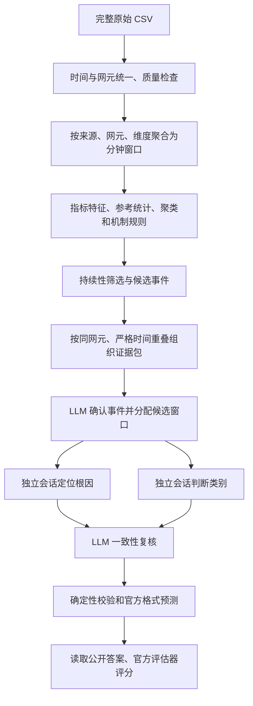

# v4 项目审查与公开样例回归

本文记录上一轮封存候选上的诊断回归。新增上游修复、原始 CSV 端到端复验及第一批全量运行状态，见 [本轮实验记录](v4-full-experiment-status.md)。下文分数与测试数对应当时的版本。

## 1. 审查结论

本次直接检查和修改了 linux2 上的 `/home/liminghang/work/CCF_AIOps_2026`，并同步维护 Mac 上的对应代码。范围包括原始数据解析、指标语义、窗口和参考统计、候选准入、证据检索、模型交互、最终导出及评分。

此前三个样例 0 分的直接原因是最终预测为空。模型已经接入，问题不是缺少 API 或尚未启动本地模型。候选阶段实际找到了三个真实故障对应的节点和时段，但后续输出协议、上下文、证据校验及复核逻辑使结果无法导出。

最终保留的 LLM 版三个样例合并得分为 **86.6436**，资源规则对照为 **93.3103**。两者都匹配三个真实故障，但均多报一个事件；LLM 还把内存和磁盘 I/O 故障判为 CPU 压力。本次解决了空预测和交互故障，尚未证明 LLM 比规则更有效。

只有三个公开样例，而且它们已用于调试与规则设计，分数属于开发回归，不能作为独立验证集性能或隐藏集得分估计。

## 2. 当前流程与问题所在



原始 CSV 不是一次性全部载入内存。解析保留原始引用、非法值和缺测信息，统一 UTC 时间及官方网元 ID。连续指标聚合为窗口统计；累计计数器计算有效差分，发生回退或间断时不猜测增量。NetFlow 使用有界缓存和 SQLite 溢出汇总。

特征按来源和完整维度分组，统计参考描述整个观测区间，不是标注的健康训练集。候选结合统计偏离、机制线索和持续性；稀有簇或普通流量变化不能单独成为故障。LLM 能拆分、拒绝或暂缓已有候选，但无法凭空发现未进入队列的异常，也无法把事件边界延伸到未交付的候选窗口。因此，上游漏检不能靠后面的提示工程修复。

当前同一 8B 模型分别执行多个角色。不同会话可以减少直接传递判断，但不能算相互独立的诊断模型；共同的分类偏差可能在复核时继续保留。

## 3. 已查明并修复的问题

| 问题 | 实际影响 | 修改 |
|---|---|---|
| 自由文本 JSON 和长窗口 ID 分配 | 多余括号、漏分配或未知 ID，使确认失败 | 本地服务采用必选函数与参数结构约束；用短窗口编号完整分组，再校验真实窗口归属、连续性和支持证据 |
| 工具返回完整矩阵和重复元数据 | 实际请求超过 32,768 token，返回 HTTP 400 | 提供紧凑指标、共享单位、有限候选序列及窄查询；补充查询限定两轮 |
| 窄查询只有提示，没有工具上限 | 模型仍请求 100 条状态，重复候选挤满上下文 | 最终结构化模式的状态查询 schema 与运行时均限制每页最多一条，保留分页能力 |
| 初始证据只展示少量靠前观测 | 模型看不到完整变化过程，查询到接口数据后错误解释节点资源 | 按时间提供最多 16 个真实候选观测及同组前后比较；完整清单保留，采样/截断明确记录 |
| 确认角色的解释传给定位和分类 | 后续重复“缺少拓扑”等判断，资源故障被连续暂缓 | 后续只接收事件范围和实际观测；保留原确认结论供审计 |
| 资源定位要求跨节点因果证明 | 本机 CPU、内存或磁盘压力因缺少拓扑被否决 | 区分本机资源定位与跨节点传播；按当前结论检查必要证据 |
| 证据同 ID 的不同投影注册顺序不一致 | 复核已接受，导出时仍触发证明不一致异常 | 实际执行与记录重放使用同一确定顺序，并增加四角色导出回归测试 |
| 分类只关注 CPU 升高 | 内存下降等更直接的机制被忽略 | 尝试了无标签资源摘要和竞争类别提示，未改善，已撤回默认诊断；数值摘要函数保留供审查 |
| 受约束生成先选择类别 | 实际先输出 category，后输出 reason，可能先选后解释 | 尝试依据先行后仍出现错误分类及更多暂缓，已撤回该实验，不把字段顺序调整当成已解决语义问题 |

程序没有补写模型结论，也没有把 rejected/deferred 改成 accepted。结构合法、证据支持、完整窗口分配及复核接受仍是 LLM 版导出的条件。结构约束解决格式问题，不能保证推理正确。

服务端函数调用约束依据 [vLLM 工具调用文档](https://docs.vllm.ai/en/latest/features/tool_calling/)。仓库保留的 BiAn 基线把设备分析、相对根因排序和类别比较拆成紧凑任务；它并不等同于当前四角色逐级否决流程。当前流程的复杂度需要通过对照实验证明价值。

## 4. 实际样例对照

全部使用三个完整公开 CSV 输入对应的封存候选。三个源 case 共扫描 1,631,293 行、185,789 个窗口，生成 4 个候选事件和 4 个证据包。诊断实验复用这些不可变证据，分别记录检测生产版本与诊断版本。

规则对照只处理节点 CPU、内存、磁盘 I/O 和磁盘空间类别，使用已生成的候选、实际资源指标和本机根因，不调用 LLM，也未覆盖其他资源子类、链路、路由或服务故障。它保留全部额外预测，用来隔离检测问题与模型拒绝问题。

| 实验 | 预测数 | TP / FP / FN | 合并 Total |
|---|---:|---:|---:|
| 修复前 LLM | 0 | 0 / 0 / 3 | 0 |
| 协议、证据与角色传递修复后的 LLM | 3 | 3 / 0 / 0 | 89.3444 |
| 资源规则对照 | 4 | 3 / 1 / 0 | 93.3103 |
| 只增加资源摘要、尚未限制查询的实验 | 3 | 2 / 1 / 1 | 58.0567 |
| 查询限额与字段顺序修改、仍展示 16 条观测 | 3 | 2 / 1 / 1 | 55.2633 |
| 摘要、依据先行及六窗口展示 | 2 | 1 / 1 / 2 | 26.9706 |
| 最终保留版本：简洁提示、结构约束、每页一条查询 | 4 | 3 / 1 / 0 | **86.6436** |

规则对照逐例为 94.9333、96.7333、90.9117。第三例在武汉监控节点多报一条。三个真实事件的根因和大小类均正确，剩余扣分来自观测边界误差及误报。

第一轮修复后的 LLM 共调用 48 次，四个包的模型角色均无协议失败。模型暂缓了第三例额外监控节点事件，最终匹配三个真实故障；但第二例内存、第三例磁盘压力都被分类为 CPU 压力。逐例为 94.9333、86.7333、86.3667，小类项仅获得 3.3333 / 10 分。第三例有一个暂缓，因此其 `diagnosis_complete=false`，不能把协议成功等同全部候选已确定。

从实际输入可看到分类偏差，并非没有提供指标：

| 真实故障对应候选 | CPU 中位数 | 内存可用比例：最初 / 候选中位数 | 磁盘忙碌率中位数 |
|---|---:|---:|---:|
| 第一例，西安服务节点 | 40.24% | 92.81% / 92.63% | 0.41% |
| 第二例，广州服务节点 | 25.92% | 92.57% / 85.18% | 1.22% |
| 第三例，武汉服务节点 | 70.81% | 92.73% / 92.57% | 99.93% |

第二例内存下降约 7.39 个百分点，第三例 I/O 忙碌接近 100%。原模型仍主要重复 CPU 升高，复核也接受了相同推理。新增摘要把这些竞争机制并排呈现，目的在于检验模型是否利用已观测事实，而不是直接给它答案。

只增加资源摘要的一轮发生退步，不能视为优化成功：第二例定位请求因查询 100 条状态后上下文超限而失败，第三例监控节点被接受为额外事件，分类仍全部偏向 CPU。实际函数参数总是先生成 category，随后才生成 reason；代码中的字母排序改变了 schema 的生成顺序。

全部试验结果都保留，不只报告最高分。最后恢复简洁的事实输入与提示，移除未证明有效的摘要/依据先行改动，保留必选函数、完整窗口分配、角色范围隔离、证据排序校验和每页一条的查询上限，重新运行全部三个样例。

最终版本共调用 48 次，四个证据包的确认、定位、分类和复核全部完成，角色协议失败和暂缓均为零。逐例 Total 为 **94.9333、86.7333、80.9117**。三个真实事件根因正确，但后两例小类仍错误；第三例额外监控节点事件也被复核接受。因此最终分数低于第一轮修复后的 89.3444，也低于资源规则对照。协议稳定没有消除模型误判，不能挑选最高分版本冒充最终结果。

最终合并评分分项为 AD **33.3103 / 40**、RCA **40 / 40**、大类 **10 / 10**、小类 **3.3333 / 10**。实际结果在服务器 `outputs/v4/official_samples_stable`，已使用官方评分 CLI 再次核对。运行时诊断代码指纹为 `ece29afd06de0e35898fc369b78127f512e36459e5bced381099089339af2b27`；随后仅清理了一行文件末尾空行，不改变运行行为。

每页两条并不单独保证上下文足够：保留 16 条初始观测的一轮，第一例在第三次请求时仍返回 HTTP 400，最终 55.2633 分。该轮的字段顺序确已生效，但真实内存、磁盘故障仍被判为 CPU；分成磁盘类别的是额外的监控节点候选。不能把这个类别变化当成分类改善。

服务端 tokenizer 对增加摘要的一轮第一例补充查询后的请求测得：展示 16 个候选观测时，输入加 1,536 输出预算为 32,967 token，超过 32,768 上限；展示 6 个时为 27,153 token。六窗口实验确实消除了该轮协议失败，但模型暂缓了前两例，评分降到 26.9706。最终不采用这个展示缩减和复杂提示组合，而移除重复摘要、限制补充查询，以保留原有事实覆盖。任何长事件仍须另查 token 和 manifest 预算。

答案只在所有预测生成后读取。推理代码没有按样例编号、答案时段、故障网元或类别筛选预测。官方评估器的权重为 AD 40、RCA 40、大类 10、小类 10；使用完整合并预测，包含第三例额外事件。样例评分是本地官方评估器结果，本次没有向比赛平台提交。

## 5. 存储与验证

相同每文件前 1,000 行试跑，共 51,481 行、41,095 个窗口：候选事件从 3,303 降到 22，证据包从 2,455 降到 22，结束时目录从约 1.8 GiB 降到 251.83 MiB。峰值进程 RAM 为 65.6 MiB，墙钟时间 3 分 47 秒。这是解析和候选阶段，不能作为检测准确率结论，也不能线性外推全量磁盘开销。

中间 JSONL 使用 gzip，SQLite JSON 载荷使用压缩 BLOB；读取兼容旧格式，封存校验仍检查内容和文件哈希。旧的 1.8 GiB 试跑已在保留诊断摘要后删除；原始数据、模型、其他实验结果和 `submit.py` 保留。后续不应删除封存目录内的单个文件，否则无法校验和复用。

最终代码在 Mac 与服务器各通过 404 项测试，包含压缩读写兼容、流式聚合、候选筛选、真实 HTTP 请求格式、窗口覆盖、未交付引用拒绝、角色隔离、不同证据投影的导出、资源摘要数值及其篡改拒绝。模型实验的语义质量另外报告，不以这些测试代替评分。

## 6. 剩余问题和下一步

1. **先保留一个可靠的资源规则对照。** 比较 LLM 是否纠正了它的误报和类别，不能只统计调用成功或输出变化。暂缓率、分类混淆和额外事件都应进入实验结果。
2. **调整整条事件的否决条件。** 当前分类暂缓会使已有时段和根因一起不导出，这是本项目的设计，不是官方评分要求。AD 与 RCA 占 80 分，类别不确定却丢掉整个事件，代价很大。应另建明确记录来源的“规则保底、LLM 受限修正”实验；不能把规则替换伪装成模型接受，也不能在复核后静默篡改类别。资源控制已验证可作为这种实验的起点。
3. **完善参考和边界。** 全区间中位数会吸收长期异常，最初观测也可能已受影响。应比较局部前后窗口或滚动参考，并在已找到候选后用原始高频观测细化起止；不要按公开答案修剪时间。
4. **减少同一模型重复判断。** 本机直接资源证据和网络传播分别处理；对类别歧义、候选冲突或跨节点事件优先使用 LLM。四角色流程先与更简单的联合诊断、受限复核做消融，再决定是否保留。
5. **检查非资源故障的召回和语义覆盖。** 当前 NetFlow、FRR 为上下文来源，静态协议零值被抑制、弱候选要求持续两窗。这些选择压低候选数量，也可能漏掉日志/流量中独有或很短的故障。例如 DNS 返回错误记录但仍响应成功，未必满足错误率/延迟准入；进程或软中断类也缺少充分的独立验证。紧凑状态投影没有直接展示完整接口/peer 维度，网络类分析仍需要原文或原始事件查询，后续应保留必要维度并验证预算。支持 32 个输出类别不等于能检测到 32 类故障，三个资源样例无法验证这些类别。
6. **比较同时间多个节点。** 当前证据包按单网元关联，确认也逐包进行。第三例服务节点与监控节点同时出现资源变化，单包判断可能把伴随现象另报为故障。需要将同期节点指标和候选事件供对比，再判断是否同一事件、受影响节点或独立故障；不能只凭重叠就合并。
7. **最后再跑全量。** 先以公开样例确认协议成功、分类质量和时间边界，再分城市或分时段测量产物规模、峰值内存和模型耗时。长事件的完整 manifest 和窗口分组 schema 仍可能超过提示预算，需要按证据连续区间分段并显式记录未处理范围，不能把超预算窗口静默截掉。当前封存复用仍会核对原始文件清单，暂不能删除原始 CSV 后直接按相同入口继续诊断。v3 的历史平台得分不能与三个公开样例分数直接比较，本次也尚未重新测量隐藏集。

## 7. 复现实验

在服务器仓库目录、项目 `.venv` 环境中，确认现有 localhost 模型服务正常。使用新输出目录：

```bash
export AIOPS_LOCAL_LLM_KEY=local-vllm
python scripts/v4_public_samples.py \
  --reuse-evidence-from outputs/v4/official_samples_compact \
  --output-dir outputs/v4/official_samples_stable_repeat

python scripts/v4_rules_control.py \
  --evidence-root outputs/v4/official_samples_compact \
  --output-dir outputs/v4/official_samples_rules_control_repeat
```

只跑 `--discovery-only` 或离线配置会停在候选证据，不产生诊断预测，不能把它的零预测当作模型实验。评分需要预测文件和已给出的公开真值；评估器本身不要求接入 LLM。
