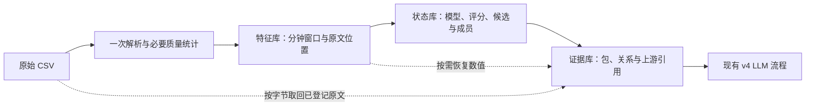

# v4 数据处理改造记录

状态：本地实现、回归与数据对照已完成。磁盘目标达成，官方样例耗时目标未达成；新后端需显式选择，旧后端仍是默认值。

## 改了什么

原流程分开做全量 profile 和特征扫描。新后端在一次 CSV 解析中同时记录必要质量信息和聚合输入，文件解析与原生序列计算使用独立工作进程；跨文件的计数器序列统一排序。

分钟窗口保存到 `features.sqlite`：网元、维度和统计说明通过字典登记，数值保持 float64，计数保持整数，缺失位与零值分开保存。状态库保存模型、评分、候选和成员关系；查询时从特征库恢复矩阵。证据库保存包、关系、少量原文快照以及上游引用，不复制完整窗口/矩阵/状态。

首次解析登记保留引用的 CSV 字节范围。原文查询只读取这些范围，并校验旧 record_id、源文件身份和来源信息；原始 CSV 仍需保留。文件读取按完整逻辑记录提交检查点，已完成原生组也能复用。

候选阈值、统计参考范围、类别规则、LLM 职责和提示词没有在本次改造中调整。



## 存储与复用的取舍

- 必要质量统计在解析时完成，不再扫描一遍原始文件计算全字段分布、基数和重复记录统计；这些字段明确登记为 `not_computed`，需要时单独运行完整 profile。
- 每个数据层按输入、参数及实际生产代码摘要封存。更换模型/提示词复用三层，修改候选参数复用特征，修改解析语义重建特征及下游。
- 数据目录同时保留不同配置的兼容版本。100 GiB 工作空间上限涵盖这些版本、暂存和 SQLite 排序/日志；达到预算停止并保留检查点，旧版本需由使用者按需清理。
- 新版使用多个工作进程，进程树内存可能高于旧版串行流程。内存预算默认 4 GiB；本地小样本结果不能作为全量内存峰值保证。
- CSV 解析后，原文仍依赖登记的原始文件。删除或改变原始 CSV 会影响原文查询与完整输入校验，不能只保留三个数据库就声称原始证据完整。

## 怎么使用

在实验配置的 `storage` 中显式选择新后端：

```json
{
  "backend": "canonical",
  "compact": true,
  "workers": 4,
  "memory_gib": 4,
  "min_free_gib": 12,
  "max_workspace_gib": 100,
  "data_dir": "/data/liminghang/CCF_AIOps_2026/data_store/stage1"
}
```

其他配置仍使用现有 v4 实验配置。`data_dir` 是生成的中间数据目录，不是原始 CSV 目录。更换模型或提示词可以复用兼容数据；原始数据/解析参数或候选参数变化分别生成新的层目录，不覆盖历史结果。

只构建数据层，不启动模型：

```bash
python -m aiops_v4.data build \
  --config configs/v4/stage1-data-canonical.json \
  --output-dir /data/liminghang/CCF_AIOps_2026/data_store/stage1 \
  --progress
```

中断后在同一命令中增加 `--resume`。先检查输入与产物，再运行后续实验：

```bash
python -m aiops_v4.data verify \
  --data-dir /data/liminghang/CCF_AIOps_2026/data_store/stage1 --raw
```

`dataset.json` 登记实际层目录。三个上游数据库必须随数据集一起保留或移动。调试需要完整 JSONL 时，可显式导出：

```bash
python -m aiops_v4.data export \
  --feature-store <dataset.json中的特征层目录>/features.sqlite \
  --output <新的导出文件路径>/windows.jsonl
```

接入现有 v4 完整实验入口时，使用带 canonical storage 的配置运行 `python -m aiops_v4.experiments run`。`agents.discovery_only=true` 表示只打通数据链路，预测数为零不代表故障评分为零。

## 当前验证记录

- 改造前实际工作代码已单独冻结，包含此前未提交修复；没有以 Git HEAD 冒充对照版本。
- 已测试 BOM、LF/CRLF/CR、空行、引号内换行、Unicode、重复表头、坏引号、源文件变化、路径越界和精确原文取回。
- 小范围窗口、模型、状态、候选事件、分页查询及候选角色输入与旧实现比较通过；浮点容差为 `rel_tol=1e-10, abs_tol=1e-12`，ID/引用/计数/缺失/质量保持一致。
- 验证了单进程与多进程构建、跨文件 counter、NetFlow 合并、中断续读、组级复用、迁移数据集与变更上游拒绝读取。
- 同步后的完整测试：Mac Python 3.13 上 469 项通过（33.72 秒），Linux 服务器 Python 3.10 上 469 项通过（88.59 秒）。
- Linux 快速改写同大小文件可能保持相同 mtime，旧测试依赖时钟自动前进而失败。现已分别固定 mtime 变化和保持不变两种情况，检查元信息校验与内容 ID 校验都拒绝修改后的原文；生产校验逻辑未改动。
- 独立审查发现的 7 项问题已修复并补回归测试：检查点取消边界、NetFlow 备用身份和非流式数值契约、首次检查点前恢复、封存发布中断恢复、完成实验复用校验、查询时重复哈希上游数据库。
- 原始引用按字节取回，查询无需重新解析整份 CSV；已预热查询不再反复计算完整数据库哈希。

## 性能结果

三个公开样例各交替运行旧/新后端三次，下表为各样例中位数；合计是三个中位数相加。对照是改造前冻结的实际工作代码，包含此前未提交的修复。

| 官方样例 | 旧版耗时（秒） | 新版耗时（秒） | 旧版产物（MiB） | 新版产物（MiB） |
|---|---:|---:|---:|---:|
| case_001 | 86.22 | 35.64 | 327.23 | 76.64 |
| case_002 | 70.43 | 30.84 | 270.28 | 64.39 |
| case_003 | 70.65 | 31.47 | 253.29 | 61.48 |
| 合计 | 227.30 | 97.96 | 850.79 | 202.52 |

最终产物为旧版的 23.8%，达到不超过 30% 的目标；耗时为旧版的 43.1%，约快 2.32 倍，**未达到不超过 1/3 的目标**。因此新后端保持显式启用，旧后端仍为默认值。

9 组完整比较均通过。三个样例的窗口数分别为 71,208、58,834、55,747，候选事件数仍为 1、1、2。比较包括全部窗口、模型、矩阵、状态、事件与证据包；只按新格式对应来源哈希字段，浮点统计使用上述容差。没有调用 LLM，也没有重新评估预测得分。

额外测试使用第一批西安数据的真实前 1,000,000 条 NetFlow，分成两个文件，并加入 32 条跨文件 counter 控制记录；只运行一次旧/新对照。旧版 83.19 秒，新版 14.06 秒，约快 5.92 倍；最终产物从 142.82 MiB 降至 32.70 MiB。两边均产生 16,851 个窗口、31 个原生组模型、1 个候选事件和 1 个证据包，完整比较通过。这是吞吐测试，不能当作第一批全量或故障评分实验。


### 暂存峰值与内存

| 输入 | CPU 秒：旧 / 新 | 采样进程树峰值 RSS（MiB）：旧 / 新 | 采样峰值磁盘（MiB）：旧 / 新 |
|---|---:|---:|---:|
| case_001 | 84.90 / 67.22 | 98.4 / 347.4 | 327.3 / 201.9 |
| case_002 | 69.58 / 58.33 | 99.4 / 337.0 | 270.3 / 168.3 |
| case_003 | 70.08 / 57.31 | 97.7 / 338.2 | 253.4 / 160.2 |
| 一百万 NetFlow + 控制记录 | 82.86 / 23.11 | 79.9 / 293.7 | 142.9 / 184.1 |

并行后的进程树内存更高，小范围实测约 294–347 MiB，低于配置的 4 GiB 预算。**最终数据库大小不等于建库峰值**：一百万条测试的新版暂存峰值约 184 MiB，高于旧版约 143 MiB，也远高于新版最终 33 MiB。公开样例和前缀测试仍不足以保证全量能放进服务器剩余空间。

三个官方样例的新版时间主要花在特征与状态计算。证据阶段不再导入完整副本或反复从文件开头定位原文，首轮已从旧版约 18–20 秒降至约 1–2 秒。下一阶段若继续追求三倍总加速，应优先处理非 NetFlow 聚合、状态计算和 NetFlow 私有暂存峰值。

### 证据与复现

原始机器记录分别在 `outputs/v4/data_redesign_final_benchmark/benchmark.json` 和 `outputs/v4/data_redesign_million_benchmark/benchmark.json`；`outputs/v4/data_redesign_acceptance.json` 汇总目标判定、实际代码摘要、对照归档摘要及百万条输入来源。每层生产代码摘要与全部运行产物登记的摘要一致。

基准命令会交替运行旧/新后端，不调用 LLM，比较窗口、模型、状态、事件及证据包。原始标签不参与构建。记录墙钟/CPU、父进程峰值 RSS、每 0.5 秒采样的进程树 RSS，以及最终和采样峰值磁盘占用。没有清空系统文件缓存，共享负载也未人为隔离。Mac 上没有采集内核实际读取字节数；报告中的 raw_input_bytes 是输入大小，csv_parse_passes 表示 profile/特征的计划全输入解析次数，不包含旧证据查询产生的额外读取。不能据此声称实际 I/O 降为一半。

```bash
python scripts/v4_data_benchmark.py \
  --cases sample/case_001 sample/case_002 sample/case_003 \
  --output-dir outputs/v4/data_redesign_recheck \
  --repeats 3 --workers 4 \
  --baseline-archive outputs/v4/data_redesign_baseline/working_sources.tar.gz
```

`--output-dir` 必须使用不存在的新目录。百万条输入的生成与对照命令：

```bash
python scripts/v4_make_data_fixture.py \
  --netflow-file data/stage1/regions/xian_20260819040000_20260902040000/xian/netflow_5tuple_minute_readable.csv \
  --output-dir outputs/v4/data_redesign_inputs/netflow_million_recheck \
  --netflow-rows 1000000

python scripts/v4_data_benchmark.py \
  --cases outputs/v4/data_redesign_inputs/netflow_million_recheck \
  --output-dir outputs/v4/data_redesign_million_recheck \
  --repeats 1 --workers 4 \
  --baseline-archive outputs/v4/data_redesign_baseline/working_sources.tar.gz
```

以上性能测量在 Mac 本地完成。随后代码已推送到 GitHub 的 v4 分支，并同步到 Linux 服务器；服务器直接访问 GitHub 超时，本次通过 SSH 传输同一提交的 Git 增量包完成快进更新。服务器原有未提交修复保存在 Git stash 中，两个独有的前缀采样配置已恢复。

代码与测试提交为 `b743504`、`1def0f6`，服务器回归日志位于仓库的 `.git/codex-sync-tests-1def0f6.log`。同步没有重新启动服务器全量任务或 vLLM，也没有提交比赛。正式全量前仍需在 Linux 服务器复测吞吐和可用磁盘；本地样例比例不能直接外推整批耗时或占用。
